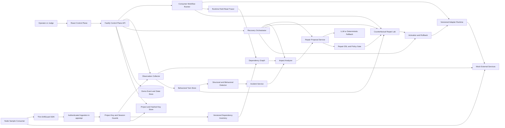

# DriftGuard Product Requirements Document

## Document control

| Item | Value |
|---|---|
| Project | DriftGuard |
| Hackathon track | PS 3 Resilient Infrastructure |
| Challenge | The Internet After the API |
| Build window | 24 hours |
| Product type | Developer-first API Dependency Intelligence and Resilience Platform |
| Status | Implementation specification; SDK onboarding upgrade, no completed-feature claims |
| Revision | 2026-10-10 — project keys, Node SDK, ingestion, and evidence-backed inventory |
| Primary audience | Product, engineering, design, QA, and hackathon judges |

This specification is reconciled with 41 local/GitHub tickets, all 37 planned routes,
97 requirement mappings and 17 connected SDK acceptance gates. See the
[ticket index](.scratch/driftguard/README.md), [API catalog](.scratch/driftguard/API_CATALOG.md),
and [coverage](.scratch/driftguard/REQUIREMENT_COVERAGE.md). These are planning artifacts;
no product ticket is implemented or closed by this reconciliation.

## 1. Executive summary

DriftGuard is a developer-first SaaS platform for discovering, observing, and safely adapting to external dependency changes. Developers create a project, issue an environment-scoped ingestion key, and connect a lightweight Node.js SDK. Explicit registrations and permitted runtime observations populate an evidence-backed dependency inventory. The control plane builds versioned behavioral twins, detects structural and behavioral drift, traces affected workflows, proposes a constrained adapter, and proves it safe before activation.

The 24-hour prototype combines one real SDK onboarding/ingestion path with the existing complete recovery loop. It is a local single-operator demonstration, not a production tenant service. The target repository currently contains planning artifacts; all behavior below is required implementation, not an assertion that a working engine already exists.

`create project -> issue key -> register dependency -> SDK ingest -> inventory and evidence`

`inject change -> observe -> detect -> explain -> trace impact -> propose -> shadow validate -> activate -> replay -> recover`

The main demonstration uses a Users API that changes `name` to `display_name`. DriftGuard must identify the change from live responses, show which workflows are affected, produce a structured field-mapping proposal, validate it against recorded traffic and workflow invariants, activate a versioned adapter, and prove that the workflows recover. A second scenario changes meaning without changing JSON shape; DriftGuard must detect conflicting behavioral evidence and refuse automatic repair.

The product's differentiator is not merely using AI to write a patch. DriftGuard treats the AI as a hypothesis generator and uses deterministic evidence to accept or reject its proposal. Its behavioral twin combines observed fingerprints, active semantic probes, runtime field-level dependency tracing, and counterfactual replay. This allows the system to explain both what changed and why a proposed adaptation preserves the application's intended behavior.

## 2. Problem statement

Modern applications depend on third-party APIs, SDKs, webhooks, MCP servers, and hosted services. These dependencies can change without warning in ways that remain syntactically valid:

- A response field is renamed or moved.
- A default value or sort order changes.
- Pagination moves from page numbers to cursors.
- Error envelopes or status codes change.
- Rate limits tighten or retry guidance changes.
- A field keeps the same name and type but changes business meaning.
- A provider becomes unavailable or intermittently degraded.

Schema validation and uptime monitoring catch only part of this problem. They generally cannot show which workflows rely on the changed behavior, whether a mapping preserves meaning, or whether a generated repair is safe to activate.

DriftGuard addresses that gap by turning dependency behavior into an observable, testable, versioned contract derived from evidence rather than documentation alone.

## 3. Product vision

Applications should be able to survive routine dependency drift without silently corrupting behavior or requiring emergency integration rewrites. DriftGuard will act as an immune layer at dependency boundaries: it remembers healthy behavior, recognizes meaningful deviations, contains the blast radius, tests a compatible response, and escalates uncertainty instead of guessing.

### Actors and customer journey

| Actor | Responsibility |
|---|---|
| A — External providers | APIs, packages/SDKs, hosted and identity services, webhooks, MCP servers; their observed behavior is evidence, not trusted instructions. |
| B — Customer applications | Install the SDK, explicitly register integrations, select collection policies, and supply authorized observations and workflow lineage. |
| C — DriftGuard | Project onboarding, ingestion authentication, inventory, behavioral analysis, impact, constrained proposals, validation, versioned activation, audit, and rollback. |

A developer creates a project/environment, issues a key once, initializes the SDK,
registers an integration, checks ingestion diagnostics, and captures an explicit
known-good baseline. Subsequent observations produce findings and evidence-linked
impact. A proposal can activate only through the existing deterministic policy and
validation gates; uncertainty remains a review hold. Versions and audit explain the
decision and allow rollback. The long-term product is dependency intelligence and
resilience; uptime and documentation are inputs, not the complete product.

### Product promise

When an external dependency changes, DriftGuard will answer five questions with evidence:

1. What behavior changed?
2. Which application workflows are affected?
3. What is the smallest permitted compatibility adaptation?
4. Does that adaptation preserve the application's expected outcomes?
5. Is the evidence strong enough for automatic activation, or is human review required?

## 4. Product principles

1. **Observed behavior outranks documentation.** Documentation is context, not proof of runtime behavior.
2. **AI proposes and deterministic gates decide.** Model confidence never substitutes for validation.
3. **Meaning matters more than valid JSON.** Domain invariants and active probes detect changes that schema diffs miss.
4. **Repair the boundary, not the whole application.** Adaptation occurs in a constrained, versioned compatibility layer.
5. **Prefer the smallest safe change.** A field mapping is better than unrestricted generated code.
6. **Uncertainty is a valid result.** Ambiguous or high-risk changes must be held for review.
7. **Every action is reversible and explainable.** Preserve the last-known-good adapter and an evidence trail.
8. **The demo must be real and repeatable.** No UI state may claim a successful test that the backend did not execute.

### 4.1 Settled implementation decisions

These decisions are binding for the 24-hour build and resolve earlier design ambiguity:

- Recovery is operator-triggered with `POST /api/incidents/:id/recover`, then fully orchestrated by the backend. The React app polls a `RecoveryRun`; it never chains recovery stages itself.
- P0 adapter operations are only `rename` and `coalesce`. `copy`, `default`, `enum_map`, and `cast` are P1 or later.
- Automatic activation is allowed only when every eligibility gate in FR-REP-07 passes. Human approval never bypasses deterministic validation.
- Rename evidence uses three stable user identities with distinct names. The preferred compatibility proposal is `coalesce [display_name, name] -> displayName`.
- A post-activation replay failure automatically restores the parent adapter, retains the failed evidence, and moves the incident to `rolled_back`.
- Reset archives the completed session, clears active demo state, restores adapter v1 and provider defaults, and starts a fresh session with no baseline.
- The deterministic repair model is the required P0 path. A live model implementation is optional and must use the same `RepairModel` contract.
- The P0 interface is an evidence-first operational workspace: solid surfaces, clear typography, a three-column impact trace, and restrained state-transition motion.
- P0 adds one Node-only SDK and sample CLI, not a fourth always-on service. The SDK reports evidence; only the backend owns detection, baselines, impact, and recovery.
- Project keys permit registration, ingestion, and SDK diagnostics only. They never authorize recovery, key administration, or access to another project/environment.
- Response metadata alone cannot establish field semantics or repair equivalence. Opt-in sanitized fixtures plus existing controlled probes/workflow invariants provide that evidence.
- Demo reset preserves project identity, key lifecycle, registered inventory, and collection policy; it archives session evidence and clears session counters/baselines as specified in section 13.2.

## 5. Unique product concept

### 5.1 The DriftGuard behavioral twin

For each observed endpoint, DriftGuard maintains a lightweight executable behavioral twin rather than a static schema. The twin contains:

- Response shape and type distributions.
- Field presence, null, and value-pattern statistics.
- Status-code and error-envelope behavior.
- Pagination and ordering behavior.
- Relevant latency and rate-limit signals.
- Known request-response examples.
- Domain invariants and active probe results.
- Versioned provider-to-canonical adapter rules.

This model is intentionally bounded. The prototype does not claim to infer arbitrary semantics from passive traffic.

### 5.2 Runtime blast-radius tracing

Instead of relying only on a manually drawn architecture diagram, workflow tests run against instrumented canonical objects. A JavaScript `Proxy` records which canonical fields each workflow actually reads. DriftGuard stores edges such as:

`welcome_email -> user.displayName`

`customer_profile -> user.displayName`

`delivery_estimate -> shipment.deliveryDays`

When provider behavior changes, DriftGuard follows the chain from changed provider behavior to the canonical adapter and then to workflows that consumed the canonical fields. This produces a field-level impact graph with fewer false positives than service-level dependency maps.

### 5.3 Semantic canaries

DriftGuard can run safe, predefined metamorphic probes that distinguish behavior with identical JSON schemas. For the delivery-days scenario, carefully selected dates around weekends expose whether `delivery_days` means calendar days or business days. The probe oracle is deterministic; the AI may suggest which approved probe to run but cannot invent or execute unrestricted requests.

### 5.4 Counterfactual repair lab

Before activation, DriftGuard replays captured requests and expected workflow outcomes through the candidate adapter in a shadow environment. It compares canonical outputs, invariants, side-effect plans, and workflow results against the last-known-good baseline. This is a counterfactual test: "If this adapter had been active, would the application still have behaved correctly?"

### 5.5 Evidence passport

Every incident produces a compact, exportable evidence passport containing the before/after behavior, detected changes, affected workflows, proposed adapter, validation results, decision, and rollback pointer. This makes the demo explainable and creates an audit artifact suitable for real engineering teams.

### Why this is different

Most AI repair demos stop at generating a plausible patch. DriftGuard makes the proposal try to survive falsification. Its differentiator is the combination of active behavioral evidence, actual workflow read tracing, constrained repair operations, and counterfactual validation. The AI is useful, but safety and credibility do not depend on trusting it.

## 6. Target users and jobs to be done

### Primary users

- Platform and site reliability engineers responsible for dependency health.
- Backend engineers who own integrations and adapters.
- Application teams whose workflows rely on external services.
- Incident responders who need fast evidence and a reversible mitigation.

### Jobs to be done

- When a dependency changes unexpectedly, tell me what changed without requiring complete provider documentation.
- Show me exactly which workflows and canonical fields are exposed to the change.
- Give me the smallest plausible compatibility repair with supporting evidence.
- Prove the repair against known workflows before it reaches active traffic.
- Stop and request review when meaning is unclear or side effects are risky.
- Let me activate, observe, and roll back a repair from one control plane.

## 7. Goals, non-goals, and success measures

### 7.1 Goals for the hackathon build

- Deliver a working React frontend and TypeScript backend.
- Simulate at least three external services with repeatable drift modes.
- Complete the field-rename recovery loop end to end.
- Detect at least one behavioral change that a JSON schema diff alone cannot prove.
- Build a field-level workflow impact map from runtime reads.
- Generate or deterministically fall back to a schema-valid repair proposal.
- Validate candidate adapters before activation.
- Refuse unsafe or semantically ambiguous automatic repair.
- Support one-click reset and a reproducible three-minute demo.
- Demonstrate project/key onboarding, explicit Users dependency registration, real SDK ingestion, and inventory linked to the same detector and workflow evidence.

### 7.2 Non-goals for the 24-hour build

- Arbitrary source-code generation or autonomous repository modification.
- Production traffic interception, production-grade tenant isolation, or distributed scaling. P0 must still enforce key-scoped project/environment writes and reads.
- Real payment execution or replay of non-idempotent operations.
- General semantic inference for unknown domains.
- Kubernetes, a service mesh, or a complex event platform.
- Integration with real third-party providers.
- A generalized agent framework or multi-agent orchestration system.
- Universal SDK interception, automatic credential discovery, arbitrary repository/lockfile scanning, autonomous API-key or authorization changes, and real MCP transport coverage.

### 7.3 Demo success measures

| Measure | Target |
|---|---:|
| Primary scenario detection | 100 percent across five consecutive local runs |
| Correct impacted workflows for field rename | 100 percent in defined fixtures |
| Unrelated workflow false positives | 0 in defined fixtures |
| Unsafe semantic repair auto-activations | 0 |
| Candidate repair validation before activation | 100 percent |
| End-to-end local recovery time excluding optional live LLM latency | Under 15 seconds |
| Demo reset time | Under 5 seconds |
| Consecutive complete demo rehearsals before submission | At least 2 |

These are acceptance targets, not claims about results that have not yet been measured.

### 7.4 Upgrade gap analysis and assumptions

| Existing gap/contradiction | Resolution in this revision |
|---|---|
| Recovery-focused vision omits developer connection | Actors A/B/C, project onboarding, Node SDK, and scoped ingestion feed the existing engine. |
| SDK instrumentation was entirely P2 | Manual Node registration/telemetry is P0; one client wrapper is P1; universal instrumentation remains a non-goal. |
| No project/key or operator boundary | Minimal hashed ingestion-key lifecycle and separate loopback operator session; explicitly limited production security. |
| Provider list is not a customer inventory | Dependency identity/provenance/version and project/environment scope separate registration from runtime activity. |
| Metadata does not prove semantics | Evidence levels, compatible fixture contexts, explicit baseline promotion, and existing controlled probes/lineage remain required. |
| Reset could invalidate onboarding or accept old telemetry | Configuration survives; sessions fence stale events; archived audit and original reset invariants remain intact. |
| Role-based plan needs concrete contributor ownership | Five contributors coordinate by live issue ownership; explicit assignment changes are reflected in the ticket index. |

Assumptions: one local Node runtime with native fetch, three loopback mock services,
one API writer, an operator-configured secret, synthetic fixture data, and no production
provider credentials. The initial repository is specification-only; first verify any
teammate implementation available before building missing recovery slices. The scope
adds a real ingestion path, not broad discovery. The main schedule risk is implementing
both security/onboarding and recovery from scratch; never replace either with fabricated
UI success. Disclose any failed P0 gate at submission rather than relabelling it done.

## 8. Scope and priorities

### Priority matrix for the connected product

| Capability | P0 — required within 24 hours | P1 — only after all P0 gates pass | P2 — production roadmap |
|---|---|---|---|
| Recovery | Existing Users rename and Shipping semantic hold, deterministic fallback, exact-hash validation, replay, rollback, reset | Existing pagination/rate-limit extensions; bounded extra DSL operations; optional live model | Staged production rollout and richer approved compatibility policies |
| Onboarding | Project creation/configuration, environment selection, issue/revoke/rotate ingestion keys, connectivity diagnostics | Additional examples | Organization membership, user identity/RBAC, audited operator administration |
| SDK | Node TypeScript package, explicit registration/manual observations, bounded queue/redaction, one CLI consumer | Selected HTTP-client instrumentation | Other languages, broad client coverage, opt-in proxy/gateway |
| Inventory | Three labelled seeded services and one genuine SDK registration mapped to Users; version/provenance/last-seen | Package-version metadata, authorized identity-provider metadata, dependency history export | Repository/lockfile scanning, generalized discovery |
| Monitoring | Existing explicit capture/observe actions and SDK evidence processing; baseline/current history | Safe configured polling, local OpenAPI import/compare, mock MCP tool fixture | Changelogs, provider webhooks, GraphQL/schema integrations, richer statistics |
| UI/security | Setup strip, one-time key display, inventory, ingestion diagnostics, existing recovery canvas; local project-scoped ingestion | Interactive graph, SSE, evidence passport | Tenant isolation, retention/deletion, compliance, data residency, CI/CD approval integrations |

P1 requires both the primary recovery test (section 21) and the SDK onboarding gates
(section 21.1), plus remaining time. P2 briefs require narrower designs before coding.
No optional integration may displace either required recovery scenario.

### P0 required

- One React control-plane dashboard.
- One Fastify control-plane API.
- One mock-provider server exposing Users, Inventory, and Shipping endpoints.
- Named consumer workflows executed by the backend.
- Baseline capture and behavioral fingerprint generation.
- Structural diff for added, removed, moved, or type-changed fields.
- Behavioral comparison for pagination or semantic-canary output.
- Runtime field-read dependency tracing.
- Incident creation with before/after evidence.
- Provider-neutral structured repair proposal through a `RepairModel` interface.
- Deterministic fallback proposal for the field-rename demo.
- Strict P0 repair DSL limited to `rename` and `coalesce`.
- Shadow replay and workflow invariant validation.
- Operator-triggered, backend-orchestrated recovery runs.
- Versioned activation, post-activation replay, and automatic rollback on replay failure.
- Ambiguous semantic scenario that is held for review.
- Reset endpoint and scripted seed data.
- Minimal project/environment records and project-key issuance, revocation, and atomic rotation.
- `packages/sdk` with explicit registration, manual HTTP tracking, diagnostics, bounded flush/shutdown, and local redaction.
- `apps/sample-consumer` CLI exercising real SDK-to-API HTTP ingestion without a live model or external provider credentials.
- Project/environment-scoped inventory and immutable baseline/latest evidence, with provenance and ingestion health in the dashboard.

### P1 if P0 is stable by hour 16

- Cursor-pagination adapter and exactly-once item validation.
- Rate-limit detection with bounded idempotency-aware retry policy.
- Optional interactive impact graph after the three-column trace is stable.
- Evidence passport export as JSON.
- Server-sent events for live stage updates.
- One supported HTTP client wrapper, opt-in safe polling, local OpenAPI comparison, package-version metadata, additional SDK examples, identity-provider public metadata, and a mock MCP fixture.

### P2 future work

- Opt-in real proxy/gateway mode and broad automatic SDK instrumentation; the thin manual Node SDK is P0.
- Generalized webhook and MCP behavior adapters; one optional mock MCP fixture is P1.
- Statistical baselines across larger traffic volumes.
- Production canaries, staged rollout, and approval integrations.
- Organization-level policy and multi-tenant data isolation.
- Repository/lockfile scanning, multiple language SDKs, changelog ingestion, advanced identity integrations, retention/deletion, data residency, and enterprise governance.

## 9. Core user journeys

### 9.0 Connect a customer application

1. The local operator creates/selects a project and `development` environment.
2. The API issues an ingestion key; the dashboard displays it once, then only its prefix/status.
3. The developer places it in the sample's server-side environment, initializes the SDK, and explicitly registers `users-api` at the seeded mock origin.
4. The sample makes real Users HTTP requests and manually tracks their metadata; for these synthetic fixtures it opts into bounded sanitized response evidence.
5. `flush()` sends a validated batch; authenticated backend ingestion reuses the observer and links the registration to the seeded Users provider.
6. Inventory shows actual last-seen/count/fingerprint and source `sdk_manual`; no baseline is promoted implicitly.
7. The operator captures a baseline using the existing workflow/probe path, then runs sections 9.2 and 9.3. SDK observations and controlled observations share endpoint identity but preserve their sources.
8. Revocation denies the old key; rotation issues a replacement once and requires reconfiguration of the sample.

### 9.1 Capture a healthy baseline

1. The operator selects **Capture baseline**.
2. The control plane calls each enabled mock provider with deterministic fixture requests.
3. The observer records responses, error behavior, and approved probe results.
4. Consumer workflows execute through the active adapters.
5. Runtime tracing records workflow-to-canonical-field reads.
6. DriftGuard saves a versioned behavioral twin and displays a healthy state.

### 9.2 Recover from a field rename

1. The operator injects `users.field-rename`.
2. The mock Users API returns `display_name` instead of `name`.
3. The `welcome_email` and `customer_profile` workflows fail their required-field invariants.
4. The observer captures the changed response.
5. The detector reports `name` removed and `display_name` added with matching value evidence.
6. The operator selects **Run safe recovery**. The API creates a `RecoveryRun` and returns `202 Accepted`.
7. The backend identifies impact, proposes the constrained mapping, runs shadow validation, and evaluates every automatic-activation gate.
8. If eligible, the backend activates the exact validated patch and replays affected workflows.
9. The UI polls the run and renders backend-confirmed stages. Successful replay moves the incident to `recovered`; a failed replay rolls back automatically.

### 9.3 Refuse an ambiguous semantic repair

1. The operator injects `shipping.business-days`.
2. The response schema remains unchanged.
3. `GET /shipping/estimate?ship_date=2026-10-09&delivery_days=3` returns `2026-10-14` instead of the baseline `2026-10-12`, violating the calendar-day invariant without changing shape.
4. DriftGuard shows the affected `delivery_estimate` workflow.
5. The repair proposal lacks evidence for a lossless conversion or exceeds the allowed risk threshold.
6. Policy sets the incident to `review_required`; no adapter is activated.
7. The last-known-good adapter remains available, and the UI explains the missing evidence.

## 10. Functional requirements

Priority definitions: P0 is required for the demo, P1 is optional after P0 is stable, and P2 is future work.

### 10.1 Scenario and provider simulation

| ID | Priority | Requirement | Acceptance criterion |
|---|---|---|---|
| FR-SIM-01 | P0 | The system shall expose Users, Inventory, and Shipping mock services over HTTP. | All three respond to seeded requests from the consumer backend. |
| FR-SIM-02 | P0 | The system shall activate a named drift scenario without source edits or server restarts. | A UI action or API call changes subsequent provider responses. |
| FR-SIM-03 | P0 | The system shall support `users.field-rename` and `shipping.business-days`. | Both scenarios are repeatable after reset. |
| FR-SIM-04 | P0 | Reset shall restore provider scenarios and adapter v1, clear active observations, incidents, patches, workflow runs, and recovery runs, archive the completed session audit, and start a fresh evidence-empty session while preserving project/key configuration (section 13.2). | After reset there is no current baseline; the next legal recovery action is **Capture baseline**, while the prior session remains read-only and stale SDK events are fenced. |
| FR-SIM-05 | P1 | The system shall support `inventory.cursor-pagination`. | The provider switches from page-number to cursor behavior. |
| FR-SIM-06 | P1 | The system shall support a rate-limit scenario with `429` and optional `Retry-After`. | Retry signals appear in observations and no payment-like action is blindly retried. |

### 10.2 Observation and behavioral twin

| ID | Priority | Requirement | Acceptance criterion |
|---|---|---|---|
| FR-OBS-01 | P0 | The system shall capture a versioned known-good baseline from real HTTP responses. | Approved control-plane fixture observations contain redacted request metadata, status, selected headers/body, time, and an available provider version label; SDK metadata-only events have explicitly absent bodies and cannot supply value-equivalence proof. |
| FR-OBS-02 | P0 | The system shall normalize volatile values before comparison. | Configured timestamps and request IDs do not create false drift incidents. |
| FR-OBS-03 | P0 | The system shall compute response shape, field presence, types, nulls, and value fingerprints. | The baseline endpoint returns a behavioral fingerprint for each observed route. |
| FR-OBS-04 | P0 | The system shall record approved semantic-canary results. | `ship_date=2026-10-09&delivery_days=3` records baseline date `2026-10-12`; the drift scenario returns `2026-10-14` with the same schema. |
| FR-OBS-05 | P0 | The system shall keep raw and normalized evidence distinct. | Incident evidence can display both forms without modifying the raw capture. |
| FR-OBS-06 | P1 | The system shall analyze pagination, ordering, latency distributions, and rate-limit behavior. Basic SDK duration/status metadata is P0 under FR-SDK-01. | Behavioral twin includes the additional analyzed dimensions when the optional scenario is enabled. |

### 10.3 Change detection

| ID | Priority | Requirement | Acceptance criterion |
|---|---|---|---|
| FR-DET-01 | P0 | The detector shall run without an LLM. | Disconnecting the LLM does not stop baseline comparison or incident creation. |
| FR-DET-02 | P0 | The detector shall classify added, removed, moved, and type-changed fields. | `name -> display_name` produces one removed-field and one added-field finding across three stable identities with distinct values. |
| FR-DET-03 | P0 | The detector shall attach before/after evidence and a deterministic fingerprint to each finding. | Re-running the same scenario does not create duplicate active incidents. |
| FR-DET-04 | P0 | The detector shall compare semantic-canary output to the baseline. | The business-days scenario produces a behavioral finding despite an unchanged schema. |
| FR-DET-05 | P0 | The detector shall grade evidence separately from repair confidence. | A high-likelihood rename can still fail repair validation. |
| FR-DET-06 | P1 | The detector shall classify pagination and rate-limit behavior changes. | Optional scenarios create the correct change type. |

### 10.4 Workflow dependency and impact analysis

| ID | Priority | Requirement | Acceptance criterion |
|---|---|---|---|
| FR-IMP-01 | P0 | The system shall define named consumer workflows with explicit inputs and invariants. | `CanonicalUser` is `{ id: string, displayName: string }`; `welcome_email` emits a stubbed intent whose nonempty `recipientName` equals baseline, and `customer_profile` emits `{ id, displayName }` deep-equal to baseline. |
| FR-IMP-02 | P0 | The system shall record canonical fields read during workflow execution. | Baseline runs persist workflow-to-field dependency edges. |
| FR-IMP-03 | P0 | The impact analyzer shall connect provider changes through adapter mappings to canonical fields and workflows. | User rename identifies `welcome_email` and `customer_profile`. |
| FR-IMP-04 | P0 | The impact report shall exclude unrelated workflows in the defined fixtures. | `inventory_sync` and `delivery_estimate` are not flagged for the user rename. |
| FR-IMP-05 | P0 | The UI shall display why each workflow is considered affected. | Each edge shows provider behavior, canonical field, and workflow invariant. |

### 10.5 Repair proposal and policy

| ID | Priority | Requirement | Acceptance criterion |
|---|---|---|---|
| FR-REP-01 | P0 | The system shall create a structured evidence bundle for repair generation. | Bundle includes incident, observations, affected workflows, canonical contract, allowed operations, fixtures, and invariants. |
| FR-REP-02 | P0 | The provider-neutral `RepairModel` interface shall return only a typed repair proposal. | Invalid JSON, unknown fields, and unsupported operations are rejected regardless of proposal source. |
| FR-REP-03 | P0 | The repair DSL shall allow only `rename` and `coalesce`. | `copy`, `default`, `enum_map`, `cast`, arbitrary code, shell commands, and network calls are rejected. |
| FR-REP-04 | P0 | The system shall provide a clearly labelled deterministic repair model for the field-rename scenario; a live model is optional. | The full demo remains operational without model credentials or connectivity, and every proposal exposes its source. |
| FR-REP-05 | P0 | Policy shall evaluate evidence strength, operation risk, endpoint side effects, and required validation. | Ambiguous semantic changes require human review. |
| FR-REP-06 | P0 | The proposal shall expose evidence, uncertainties, validation plan, and approval recommendation. | All fields are visible in the incident panel. |
| FR-REP-07 | P0 | Automatic activation shall require every eligibility gate: read-only endpoint; structural rather than semantic drift; only `rename` or `coalesce`; value equivalence across known identities; no proposal uncertainty; replay-safe affected workflows; passing canonical schema and all affected workflow invariants; validation hash equal to candidate patch hash; and no unrelated workflow regression. | Removing any single gate prevents activation. Semantic, conflicting, high-risk, or insufficient evidence yields `review_required`; invalid proposals or failed deterministic validation yield `rejected`. |
| FR-REP-08 | P0 | Human review shall not waive a failed or missing deterministic check. | A `review_required` incident can resume only after new evidence or a revised proposal passes all required validation. |

### 10.6 Validation, activation, and rollback

| ID | Priority | Requirement | Acceptance criterion |
|---|---|---|---|
| FR-VAL-01 | P0 | The validator shall apply the candidate adapter in isolation. | Active behavior is unchanged during validation. |
| FR-VAL-02 | P0 | The validator shall replay captured provider responses through the candidate adapter. | Canonical output matches required baseline semantics for the rename fixture. |
| FR-VAL-03 | P0 | The validator shall replay affected workflows and evaluate their invariants. | Both user workflows pass before a patch becomes activatable. |
| FR-VAL-04 | P0 | Validation shall fail when required fields are missing, types are wrong, or invariants fail. | A deliberately invalid `display_name -> id` mapping is rejected. |
| FR-VAL-05 | P0 | Activation shall accept only a patch with a passing validation record for the exact candidate patch hash. | Direct activation of an unvalidated or modified patch returns a conflict error. |
| FR-VAL-06 | P0 | Activation shall preserve the prior adapter as last known good. | Rollback restores the previous adapter version and workflows can be replayed. |
| FR-VAL-07 | P0 | The system shall never replay non-idempotent external side effects during shadow validation. | Side-effecting steps produce recorded intents or stubs only. |
| FR-VAL-08 | P0 | A failed post-activation workflow replay shall automatically roll back the parent adapter and preserve the failed patch and evidence. | The incident becomes `rolled_back`; audit events contain activation and rollback, and the parent adapter is active. |
| FR-VAL-09 | P0 | Infrastructure failures shall fail the `RecoveryRun` without inventing an incident transition. | The incident remains in its last valid state and the run exposes a safe failure reason. |

### 10.7 Recovery orchestration

| ID | Priority | Requirement | Acceptance criterion |
|---|---|---|---|
| FR-REC-01 | P0 | `POST /api/incidents/:id/recover` shall create one backend-owned recovery execution and return `202` with `recoveryRunId` and `incidentId`. | A concurrent request for the same incident returns `409 RECOVERY_ALREADY_RUNNING` with the active `recoveryRunId` in safe error details. |
| FR-REC-02 | P0 | A `RecoveryRun` shall expose status `queued \| running \| succeeded \| failed` and stage `impact \| proposing \| validating \| activating \| replaying \| rolling_back`, with timestamps and an optional failure reason. | `GET /api/recovery-runs/:recoveryRunId` is sufficient for UI polling. |
| FR-REC-03 | P0 | The backend orchestrator shall own impact, proposal, validation, activation, replay, and rollback sequencing. | The frontend calls one recovery command and never derives or advances backend state. |
| FR-REC-04 | P0 | Guided individual stage actions shall remain available for inspection and rehearsal. | Each action uses the same domain services, state guards, evidence, and audit events as automatic recovery. |

### 10.8 Frontend control plane

| ID | Priority | Requirement | Acceptance criterion |
|---|---|---|---|
| FR-UI-01 | P0 | The dashboard shall show provider health, active scenarios, and baseline status. | Status is loaded from the backend, not hard-coded. |
| FR-UI-02 | P0 | The dashboard shall expose **Run safe recovery** plus guided capture, inject, observe, propose, validate, activate, rollback, replay, and reset actions. | Recovery starts once, polls its run, and every action shows backend-confirmed loading, success, or error state. |
| FR-UI-03 | P0 | The incident view shall show before/after evidence and change classification. | A judge can see `name` removed and `display_name` added. |
| FR-UI-04 | P0 | The impact view shall show provider-to-canonical-to-workflow relationships. | Affected and unaffected workflows are visually distinguishable. |
| FR-UI-05 | P0 | The repair view shall show the constrained adapter diff and validation results. | No patch is presented as active until the backend confirms activation. |
| FR-UI-06 | P0 | The UI shall distinguish `detected`, `proposed`, `validating`, `validated`, `active`, `review_required`, `rejected`, `rolled_back`, and `recovered`. | State labels match the incident state machine. |
| FR-UI-07 | P0 | The UI shall provide a guided demo mode. | The next legal action is prominent and illegal actions are disabled with an explanation. |
| FR-UI-08 | P1 | The dashboard shall update stages through server-sent events. | Timeline progresses without manual refresh. |
| FR-UI-09 | P0 | The dashboard shall use an evidence-first operational layout and restrained visual language. | Solid surfaces, clear type hierarchy, visible focus, three-column impact trace, no decorative gradients, glass effects, neon glow, bento collage, amorphous blobs, excessive nested cards, or continuous animation. |

### 10.9 Audit and operations

| ID | Priority | Requirement | Acceptance criterion |
|---|---|---|---|
| FR-OPS-01 | P0 | Every recovery run, proposal, validation, activation, replay, rollback, and reset shall create an audit event. | Incident timeline is derived from stored events. |
| FR-OPS-02 | P0 | The system shall expose health endpoints for the control plane and mock providers. | Startup script can verify readiness. |
| FR-OPS-03 | P0 | The repository shall include example environment variables and one-command local startup. | A new team member can start the demo from the README. |
| FR-OPS-04 | P1 | The system shall export the incident evidence passport as JSON. | Downloaded content matches the selected incident and patch versions. |

### 10.10 Projects, keys, SDK, and dependency inventory

| ID | Priority | Requirement | Acceptance criterion |
|---|---|---|---|
| FR-PRJ-01 | P0 | Create a named project with `development` and `production` environment identities and collection policy. | Dashboard-created project returns a stable ID; all observations/inventory records carry project/environment/session scope. Production is a label in the local demo, not a production hosting claim. |
| FR-KEY-01 | P0 | Issue high-entropy, project/environment-scoped ingestion keys; persist only a digest and safe key metadata. | Plaintext appears once at issuance with `Cache-Control: no-store`; list/detail/audit never return it. |
| FR-KEY-02 | P0 | Revoke and rotate keys server-side. | Old key fails after revocation or atomic rotation; a lost issuance response requires a new rotation, not plaintext recovery. |
| FR-KEY-03 | P0 | Authorize ingestion and diagnostics from the key's bound scope, independently of operator actions. | Invalid/revoked key returns `401`; valid wrong-scope key returns `403`; ingestion credentials cannot execute recovery or manage keys. |
| FR-SDK-01 | P0 | Provide a Node TypeScript SDK with explicit init, registration, manual tracking, flush, diagnostics, and shutdown. | Sample imports `@driftguard/sdk`, registers Users, and submits real HTTP metadata using its issued key. |
| FR-SDK-02 | P0 | Bound telemetry queues, batches, attempts, timeouts, and background work; fail without crashing the host. | Fake-clock/transport tests assert section 12.5 bounds, no unhandled rejections, and host workflow success during control-plane outage. |
| FR-SDK-03 | P0 | Redact locally and collect metadata by default; response evidence requires explicit policy. | Authorization/cookies/configured paths are absent before transport; only synthetic allowlisted response evidence is enabled in the sample. |
| FR-ING-01 | P0 | Authenticate, validate, redact again, normalize, and deduplicate SDK events before existing observer/detector processing. | Same event retry has no repeated side effects; conflicting event ID returns `409`; invalid batches have no partial persistence. |
| FR-ING-02 | P0 | Fence observations to an active session and keep baseline promotion explicit. | Stale-session batch returns `409`; no-baseline observations remain candidates; latest evidence never overwrites the baseline. |
| FR-INV-01 | P0 | Version dependencies by project/environment and explicit registration identity. | Seeded Users/Inventory/Shipping are labelled; SDK Users registration links to the same provider without duplicating a dependency on retries. |
| FR-INV-02 | P0 | Expose source, confidence, last seen, observation count, baseline/latest versions, and integration diagnostics. | Dashboard derives status/counts from accepted backend events; seeded records do not invent runtime activity. |
| FR-LIN-01 | P0 | Preserve evidence/provenance on provider→endpoint→client→adapter→workflow links. | Proven workflow impact requires existing field-read evidence; metadata-only/manual links render as declared or inferred, not confirmed. |
| FR-MON-01 | P0 | Keep append-only observation/version history and classify evidence maturity separately from incident lifecycle. | Findings link before/after evidence and source; one anomaly cannot be labelled a provider-wide confirmed change. |
| FR-UI-10 | P0 | Add project/environment setup, one-time keys, inventory, and ingestion diagnostics to the existing canvas. | User connects the sample without losing the recovery action hierarchy; secrets are not saved in frontend storage. |
| FR-DIS-01 | P1 | Add one explicitly supported HTTP client wrapper, safe configured polling, and local OpenAPI comparison. | Each optional integration has bounded tests, provenance, and authorization; registering a URL alone never starts polling. |
| FR-DIS-02 | P1 | Support a mock MCP fixture and explicitly authorized public identity-provider/package metadata. | UI labels fixture/metadata source and inferred relationships; no private token or universal-tool discovery claim. |
| FR-DIS-03 | P2 | Extend to broad scanning, feeds, language SDKs, and opt-in proxy/MCP production integrations. | Separate design and threat model required before implementation; original recovery gates remain authoritative. |

## 11. Non-functional requirements

| ID | Category | Requirement | Target or verification |
|---|---|---|---|
| NFR-01 | Safety | No model output may execute as arbitrary code. | Only schema-validated DSL operations reach the adapter runtime. |
| NFR-02 | Reliability | The primary demo must not require an external LLM to finish. | Deterministic fallback is covered by integration tests. |
| NFR-03 | Determinism | Reset followed by baseline capture must produce equivalent fingerprints. | Stable fixture test passes across repeated runs. |
| NFR-04 | Performance | Local detect-to-incident processing shall complete quickly enough for a live demo. | P95 under 2 seconds for seeded scenarios on a developer laptop, excluding LLM latency. |
| NFR-05 | Recovery | Rollback shall restore last-known-good behavior. | Integration test activates a patch, rolls back, and verifies the prior version. |
| NFR-06 | Explainability | Every automated decision shall link to evidence and policy results. | UI and API expose reason codes, not only a confidence number. |
| NFR-07 | Availability | A missing model key shall disable only optional live proposal generation. | The required deterministic `RepairModel`, detection, impact, validation, recovery, and reset all pass offline. |
| NFR-08 | Security | Provider/model secrets remain server-side and outside responses/logs/commits; a new ingestion key appears only in its authenticated one-time issuance response and transient setup UI. Operator bootstrap input is transient. | `.env.example` contains placeholders only; sanitizer and issuance tests cover headers, persisted key records, safe reads/audit, and cleared frontend state. |
| NFR-09 | Privacy | Captured headers and bodies shall pass through configurable redaction before persistence. | Authorization, cookies, and configured fields are redacted. |
| NFR-10 | Accessibility | The primary UI flow shall be keyboard usable with visible focus and semantic status text. | Manual keyboard pass and automated accessibility smoke test. |
| NFR-11 | Compatibility | The demo shall run in current Chromium-based browsers and on one local Node runtime. | Smoke test in the presentation environment. |
| NFR-12 | Maintainability | Detection, impact, repair, validation, and adapters shall have package boundaries and typed contracts. | No frontend import reaches backend internals; shared types come from `packages/contracts`. |
| NFR-13 | Observability | Each run shall carry a correlation ID across observation, incident, patch, and workflow replay logs. | A complete scenario can be filtered by one ID. |
| NFR-14 | Auditability | Audit events shall be append-only within each demo session. | Reset closes and archives the current session with a reset event, then creates a clean session. |
| NFR-15 | Testability | Core logic shall be callable without HTTP or UI. | Unit tests invoke detector, impact, policy, and validator as pure services. |
| NFR-16 | Demo resilience | The full demo shall reset without process restarts or source changes. | Two consecutive three-minute rehearsals complete successfully. |
| NFR-17 | State integrity | Execution progress and incident truth shall remain separate. | An infrastructure failure marks only its `RecoveryRun` failed; the incident retains its last valid domain state. |
| NFR-18 | Visual clarity | The primary screen shall optimize evidence comparison and operational decisions over decoration. | Review confirms one clear action hierarchy, solid surfaces, compact density, and motion limited to user actions or state changes with reduced-motion support. |
| NFR-19 | SDK isolation | Telemetry loss or outage shall not alter customer workflow results. | Track methods return bounded diagnostics rather than throwing; background failures are caught; flush/shutdown have deadlines. |
| NFR-20 | Ingestion security | Keys are scoped, hashed, redacted, revocable, and rate limited. | Cross-project/environment negative tests, key lifecycle tests, limits and malformed-batch tests pass. |
| NFR-21 | Collection privacy | Default telemetry contains no body/header values, query values, credentials, or arbitrary environment values. | Serializer/transport-boundary tests verify policy on nested hostile inputs and explicitly enabled fixture evidence. |
| NFR-22 | Resource bounds | Collection/ingestion obey section 12.5 and 16.1 numeric limits. | Overflow, retry, payload, timer, concurrency, and retention tests use a deterministic clock. |
| NFR-23 | Production readiness | TLS, operator identity/RBAC, durable tenant isolation, explicit retention/deletion, and authorized egress are production release gates, not P0 claims. | A production checklist and separate security review precede any deployment beyond the loopback demo. |

## 12. System architecture

### 12.1 Architecture decision

Use a TypeScript monorepo with three always-on applications and focused internal packages, plus one Node sample CLI run on demand. This preserves real HTTP boundaries without spending the sprint on microservice orchestration.

- **Web app:** React, Vite, TypeScript, and Tailwind CSS. Start with a three-column impact trace; add React Flow only if it materially improves comprehension after P0 is stable.
- **Control-plane API:** Fastify and TypeScript. Owns observation, detection orchestration, workflows, incidents, repair, validation, activation, and audit.
- **Mock-provider server:** Fastify and TypeScript. Hosts independent route plugins for Users, Inventory, and Shipping with scenario toggles.
- **Contracts and validation:** Zod schemas shared between frontend, backend, and test fixtures.
- **Persistence:** Lowdb JSON store behind repository interfaces for zero-setup demo persistence. In-memory repositories are used by unit tests.
- **Testing:** Vitest for unit and integration tests; Playwright for one golden-path browser test if time permits.
- **AI:** Provider-neutral `RepairModel` interface with the deterministic implementation required for P0 and a live implementation only if credentials and schedule allow.
- **SDK:** `packages/sdk` is a Node-only public API using native fetch/abort/timers; schemas come from `packages/contracts`, SDK sanitization from the browser-free pure `packages/observer` redaction module. It never imports detector, repair, adapter execution, backend services, or model credentials.
- **Ingestion:** routes and focused auth/project/ingestion services inside `apps/api`, using the existing Lowdb/in-memory repository seams. No queue broker, new ingestion server, or generalized discovery framework.
- **Customer example:** `apps/sample-consumer` CLI makes real mock-provider requests, calls the SDK manually, and exits after bounded shutdown. Existing backend consumer workflows remain the authoritative P0 recovery demonstration.

### 12.2 Logical architecture



### 12.3 End-to-end recovery sequence

```mermaid
sequenceDiagram
    actor Operator
    participant UI as React UI
    participant API as Control Plane
    participant Provider as Mock Users API
    participant Detector
    participant Impact
    participant Repair
    participant Validator
    participant Adapter

    Note over API,Detector: SDK batches feed the same observer/detector; the following controlled fixtures prove recovery
    Operator->>UI: Inject field rename
    UI->>API: POST scenario inject
    API->>Provider: Enable users.field-rename
    loop u-123, u-456, u-789
        API->>Provider: Observe GET users/:id
        Provider-->>API: stable id and display_name
    end
    API->>Detector: Compare with known-good twin
    Detector-->>API: equivalent rename evidence across three identities
    Operator->>UI: Run safe recovery
    UI->>API: POST incident recover
    API-->>UI: 202 recoveryRunId
    API->>Impact: Resolve changed provider fields
    Impact-->>API: welcome_email and customer_profile
    API->>Repair: Generate constrained proposal
    Repair-->>API: coalesce display_name then name to displayName
    API->>Validator: Shadow replay candidate and unrelated workflows
    Validator->>Adapter: Apply candidate in isolation
    Validator-->>API: All eligibility gates pass
    API->>Adapter: Set active version
    API->>Provider: Replay affected workflows
    UI->>API: GET recovery run
    API-->>UI: succeeded and incident recovered
```

### 12.4 Safety boundary

The model is outside the trusted execution boundary. Its output becomes data, not code. The trusted backend must:

1. Parse the response into a Zod schema.
2. Reject unsupported fields or operations.
3. Resolve all paths against known provider and canonical contracts.
4. Evaluate policy and risk rules.
5. Execute the candidate only in the adapter interpreter.
6. Validate against the same immutable patch hash that may later be activated.

### 12.5 Developer SDK contract and failure isolation

```typescript
import { DriftGuard } from "@driftguard/sdk";

const driftguard = new DriftGuard({
  apiKey: process.env.DRIFTGUARD_API_KEY!, // server-side only
  projectId: process.env.DRIFTGUARD_PROJECT_ID!,
  endpoint: process.env.DRIFTGUARD_ENDPOINT ?? "http://127.0.0.1:4000",
  environment: "development",
  allowInsecureLoopback: true, // local demo only
  collection: { responseEvidence: "allowlisted_fixture", allowedBodyPaths: ["$.id", "$.name", "$.display_name"] },
});
const registration = await driftguard.registerDependency({
  name: "users-api", type: "rest-api", baseUrl: "http://127.0.0.1:4001",
});
// Only track after the actual provider request; pass a response subset, not a fetch Response.
if (registration.ok) driftguard.trackRequest({
  dependencyId: registration.dependencyId, method: "GET", routeTemplate: "/users/:id",
  statusCode: 200, durationMs: 42, observedAt: new Date().toISOString(),
  fixtureKey: "user:u-123", responseEvidence: { id: "u-123", name: "Aarav" },
});
await driftguard.flush();
await driftguard.shutdown();
```

The example's literal event illustrates the API; the executable sample obtains status,
duration, time, and evidence from real requests for all three fixture identities.
Default initialization omits `collection` and emits metadata only. Resolve project and
environment from authenticated registration/diagnostics, validating configured values
for equality. Never infer environment by transmitting arbitrary process configuration.

| Public API | Required behavior |
|---|---|
| `new DriftGuard(config)` | Validate local config without network work. Invalid config disables collection and exposes diagnostics; never throw into host execution. Key is held in memory only. Package version comes from the built SDK, not customer-supplied telemetry. |
| `registerDependency(input)` | Async authenticated explicit upsert; returns `{ ok: true, dependencyId, sessionId }` or `{ ok: false, code }`. No host failure/implicit interception; registration must succeed before tracking. |
| `trackRequest(input)` | Synchronous validation/redaction/enqueue; returns `{ queued: boolean, code? }`. Accept only a known registration and explicit route template; no network calls or automatic baseline promotion. |
| `flush()` | One in-flight drain; concurrent callers share the promise. Returns accepted/duplicate/dropped counts and safe code. It resolves on outage/auth errors, never leaves an unhandled rejection. |
| `diagnostics()` | Local counts, active session, last acknowledged ingest, dropped events, last safe error and SDK version. Server connectivity comes from scoped registration or `GET /api/sdk/diagnostics`; queued events are not reported ingested. |
| `shutdown()` | Stop timer, refuse new tracking, attempt bounded final drain, dispose resources, return unsent count. No process exit hooks or process termination installed automatically. |

**P0 bounds (targets/configured limits, not measured results):** queue at most 100 events
and 512 KiB serialized bytes; drop newest on overflow and count loss. At most 20 events
and 128 KiB per batch; 16 KiB per event including an optional 8 KiB response subset.
Auto-flush every 5 seconds using an unreferenced timer; reaching a batch threshold can
schedule one nonblocking flush. One HTTP request in flight. Registration uses a 2-second
timeout and no automatic retry. A batch attempt times out in 2 seconds; at most two retries
with 250/500 ms capped backoff, and a 7-second total flush deadline; shutdown has an
8-second deadline. Retry only transient network/timeout, `429`, and `5xx`, with the same
event IDs. Respect `Retry-After` up to remaining deadline; longer delays terminate this
flush and drop its attempted batch with diagnostics. Permanent `4xx` terminate retries;
`401/403` disable sending until explicit reconfiguration, and stale-session `409` requires
fresh registration. Drop attempted unsent events when the deadline/attempt budget ends;
telemetry is best-effort, with no offline disk spool. Neither network failure nor invalid
telemetry changes the application's provider response or its workflow result.

Collection policy: strip URL userinfo/query/fragment, prohibit credentials and arbitrary
environment data, default to no header values or bodies. Locally redact explicitly enabled
allowlisted fixture bodies and configured sensitive paths before serialization. Bound
JSON to depth 8, 100 keys, and 1 KiB strings; reject excess and non-JSON values/cycles.
Policies may lower limits and disable evidence; P1 configurable sampling defaults to
metadata-only, while P0 uses bounded 100% sample telemetry. Redaction reduces permitted
data, not a promise to recognize every possible secret in arbitrary values.
Validate the configured ingestion endpoint as HTTPS; allow HTTP only for literal
loopback/localhost with explicit `allowInsecureLoopback`. Do not follow redirects or
forward a bearer key to a different origin. Invalid endpoints disable collection.

### 12.6 Onboarding and ingestion pipeline

`SDK registration -> key/project/environment/session guards -> strict batch validation
-> local-policy verification and server redaction -> deduplication -> observer normalization
-> latest fingerprint/history -> existing detector -> findings/incidents -> existing lineage`

1. Resolve scope from the active key; client IDs are equality checks, never authority.
2. Require backend-issued dependency/endpoint identity and active `sessionId`. Registration
   creates a stable dependency; the server assigns endpoints from method/route pairs without
   fetching registered URLs. Unknown dependencies return `404`.
   P0 project creation assigns a versioned server-owned demo policy: metadata-only for
   general dependencies, with synthetic Users evidence permitted only for reviewed fixture
   keys and paths `$.id`, `$.name`, `$.display_name`. Effective SDK collection is the
   intersection of explicit local opt-in and that registration-returned policy; defaults
   stay metadata-only. The SDK attaches the server-assigned policy version automatically.
   Policy expansion or arbitrary customer body capture requires a later reviewed API;
   there is no P0 collection-policy administration route.
3. Batch schema is strict, version `1`; reject invalid events before any persistence. Check
   event IDs/content digests inside a serialized repository transaction; same ID and content
   is duplicate, same ID with different content is `409 EVENT_ID_CONFLICT`. Dedup namespace
   is project/environment/session/event ID and increments counters exactly once.
   Batch identity uses the same scope: the same batch ID must retain the same immutable
   event list/content digest; different content is `409 BATCH_ID_CONFLICT`. Exact retries
   return the original batch acknowledgement without repeating mutations/audit.
4. Convert valid timestamps to UTC ISO, rejecting invalid dates and more than 5 minutes in
   the future; more than 24 hours old is `400 INVALID_INPUT`. Out-of-order events within
   that window are historical only: they cannot replace newer `latest` pointers or create/
   reopen active findings/incidents or change repair eligibility. Deliberate operator
   re-evaluation would require a separately audited future action. Template paths contain
   no queries or concrete user IDs; the
   server validates length ≤256 and maps them to method+dependency+route identity.
5. Fingerprint after redaction/normalization. Compare only compatible scope, endpoint,
   collection-policy version, and fixture/probe context; changed usage/cohort or visibility
   is an evidence-gap/usage finding, not proof of a provider change. A fingerprint alone
   does not prove value equivalence. SDK fixtures are customer-reported; the P0 auto-repair
   gate still requires controlled three-identity HTTP evidence and workflow validation.
   Seeded baseline capture and the sample share server-approved fixture keys
   `user:u-123`, `user:u-456`, `user:u-789` and the same allowed identity/name evidence
   policy. Source labels remain distinct; redaction-policy changes require recapture or
   an explicit compatible projection, never comparison of hidden and missing fields.
6. Maintain independent immutable baseline versions and latest observations. Without an
   explicit known-good capture, observations are baseline candidates and inventory evidence,
   not confirmed drift against a fabricated baseline. Capture reuses the existing endpoint
   and workflow/probe service; registration or ingestion never promotes a baseline.
7. Persist findings through the existing detector/incident service, scoped dedup fingerprint,
   and correlation IDs. Ingestion accepts no repair/probe/source-code instructions. The SDK
   never modifies host source or executes a candidate patch.

## 13. Domain model

| Entity | Purpose | Key fields |
|---|---|---|
| Project | Customer application boundary | `id`, `name`, `createdAt`, `collectionPolicyVersion` |
| ProjectEnvironment | Scope and ingestion lifecycle | `projectId`, `environment`, `activeSessionId`, `lastIngestAt`, `collectionPolicy` |
| ProjectKey | Ingestion-only credential metadata | `id`, `projectId`, `environment`, `digest`, `prefix`, `status`, `createdAt`, `revokedAt`, `lastUsedAt`, `replacesKeyId` |
| Dependency | Versioned registered integration inventory | `id`, `projectId`, `environment`, `providerId?`, `name`, `type`, `baseUrl?`, `packageId?`, `inventoryVersion`, `provenance`, `firstSeenAt`, `lastSeenAt?`, `observationCount`, `health`, `confidence`, `baselineVersion?`, `latestFingerprint?`, `collectionPolicyVersion` |
| IngestionBatch/Event | Sanitized SDK delivery and retry identity | `batchId`, `eventId`, `projectId`, `environment`, `sessionId`, `dependencyId`, `sdkVersion`, `receivedAt`, `contentDigest`, `processingStatus` |
| Provider | External dependency under observation | `id`, `name`, `baseUrl`, `riskClass`, `enabled` |
| Endpoint | Observable provider operation | `id`, `providerId`, `method`, `path`, `idempotency`, `probePolicy` |
| Observation | Immutable sanitized evidence from one request | `id`, `projectId`, `environment`, `sessionId`, `dependencyId`, `endpointId`, `source`, `evidenceLevel`, `request`, `response?`, `observedAt`, `receivedAt`, `fixtureKey?`, `collectionPolicyVersion`; `scenarioId` is demo ground truth only, never detector input |
| BehavioralTwin | Versioned normalized behavior | `id`, `endpointId`, `version`, `fingerprint`, `examples`, `invariants` |
| ChangeFinding | One evidence-backed difference | `id`, scoped `fingerprint`, `type`, `path`, `beforeRefs`, `afterRefs`, `source`, `observedAt`, `detectedAt`, `evidenceStrength`, `evidenceStatus`, `dependencyIds`, `workflowIds`, `limitations` |
| Incident | Lifecycle wrapper around related findings | `id`, `providerId`, `status`, `severity`, `fingerprint`, `createdAt` |
| RecoveryRun | Backend-owned execution progress separate from incident truth | `id`, `incidentId`, `status`, `stage`, `startedAt`, `finishedAt`, `failureReason` |
| Workflow | Named consumer behavior | `id`, `name`, `riskClass`, `invariants`, `sideEffectPolicy` |
| DependencyEdge | Evidence-labelled dependency/field relationship | `fromId`, `toId`, `relation`, `provenance`, `evidenceRefs`, `workflowId?`, `canonicalPath?`, `readCount?`, `firstSeenAt`, `lastSeenAt`, scoped IDs |
| AdapterVersion | Provider-to-canonical mapping | `id`, `providerId`, `version`, `operations`, `state`, `parentId` |
| RepairProposal | Candidate adaptation and rationale | `id`, `incidentId`, `adapterVersionId`, `source`, `evidence`, `uncertainties` |
| ValidationRun | Immutable validation result | `id`, `patchHash`, `checks`, `result`, `startedAt`, `finishedAt` |
| AuditEvent | Append-only event timeline | `id`, `correlationId`, `type`, `actor`, `payload`, `createdAt` |

All evidence, endpoint, twin, workflow, incident, adapter, proposal, validation, and audit
lookups inherit `projectId`, `environment`, and `sessionId`; never resolve by a bare
user-supplied ID across scopes. Provider is the external service identity; Dependency
is one application's registered integration with that provider. P0 reserves names
`users-api`, `inventory-api`, and `shipping-api` with a backend-owned seeded mapping.
An SDK upsert matches project/environment/name and normalized origin; origin/type
conflicts return `409 DEPENDENCY_CONFLICT`. Arbitrary registrations remain unlinked
until an operator supplies a reviewed mapping. Endpoint identity is dependency+method+
route template; matching an unrelated application's URL does not prove common usage.

### 13.1 Project keys and operator administration

- P0 supports a local single operator with project/environment-scoped ingestion, not
  organization/user tenancy. Bind the API and Vite proxy to loopback; reject non-local
  operator access and unapproved browser origins. Production hosting is outside P0.
- A backend-only `DRIFTGUARD_OPERATOR_TOKEN` is configured before startup. A local
  dashboard operator enters it into `POST /api/operator/session`; validate it server-side
  and issue a random in-memory `HttpOnly; SameSite=Strict; Path=/api` session cookie.
  Production requires `Secure` cookies/TLS. Do not keep the token in frontend config,
  localStorage, analytics, or console logs. State-changing operator routes verify Origin
  against the exact configured UI origin, including bootstrap. Requests without Origin
  require `X-DriftGuard-Operator-Token` for loopback scripted demo tests; redact this
  header before logging. Scripts can bootstrap with this same header and matching body
  token; ingestion never accepts it. Sessions expire after 8 hours; no refresh/OAuth
  system is required for the local demo.
- All existing `/api/*` control-plane reads/mutations except minimal public health require
  this operator context, including recovery, reset, observation runs, and key actions.
  Ingestion routes instead accept only a project ingestion bearer key. These credential
  classes cannot substitute for one another. The one-time ingestion key display is an
  intentional authenticated issuance response, not permission to expose provider keys.
- Issue `dg_ing_<keyId>.<secret>` with 32 cryptographically random secret bytes, encode
  base64url, and persist SHA-256 of the complete key plus safe prefix/status/scope metadata.
  Resolve `keyId`, hash the supplied token, and compare fixed-length digests with a
  timing-safe comparison. No plaintext key is recoverable from list/audit records.
- Atomic rotation creates a replacement and revokes the old key in one serialized store
  update. Plaintext returns only after persistence. If the response is lost, the operator
  issues another rotation; do not replay plaintext through an idempotency cache. Revoke
  is idempotent and denies later requests. P0 maximum 3 active keys per environment;
  development and production keys are distinct and cannot cross environments.
- An already-accepted batch may finish after revocation; the key is checked again before
  each new request is accepted. Audit issue/rotate/revoke/use failure with key ID and
  safe actor/correlation, never token/digest. Redaction applies before all request logging.
- Provider credentials are independent: project keys authorize sending telemetry to
  DriftGuard, never calls to an external provider. P0 uses only credential-free mocks.
  Monitoring does not require uploading a customer's credentials or environment.

### 13.2 Session, retention, and baseline ownership

Each project/environment has one active demo session. Reset is scoped to the selected
environment and retains project/key lifecycle, collection policy, inventory identity,
and declared integration edges. It archives that session's observations, fingerprints,
findings, incidents, runtime read edges, runs, and audit; restores adapter v1 and provider
defaults; clears session counts/latest pointers/baselines; and assigns a new session ID.
Lifetime first/last-seen and total counts are distinct from active-session counters.
Runtime lineage must be recaptured; preserved declared edges are not proof of runtime reads.

The shared mock process can serve only one active project/environment demonstration
at a time. First baseline capture atomically acquires and pins the global demo lease
to that scope until its owner resets. Capture/observe/scenario/recovery/replay actions
from other scopes get `409 DEMO_SCOPE_BUSY`; none can capture a baseline from another
scope's changed mock state. A non-owner reset also returns this conflict. Owner reset
restores providers, archives state, and releases the lease; a newly captured baseline
can then pin it again. Other control actions without baseline are refused by existing
state guards. Passive SDK registrations/ingestion remain scoped and never change
scenarios or acquire/release the lease; SDK-reported evidence alone cannot activate
an adaptation to these shared mocks. Reset is blocked during an active action;
serialized session guards prevent races with ingestion commits. Stale queued events
are rejected, never relabelled into the new session.

P0 retains at most 1,000 observations or 10 MiB of bounded sanitized evidence per
session, refusing new observations with `429 RETENTION_LIMIT` when full rather than
deleting baseline/incident evidence. Retain baseline versions and linked evidence
until explicit demo data deletion; reset is archive, not deletion. SDK delivery dedup
records live with their session. Lowdb is serialized within one API process; it is not
a distributed or tamper-proof audit/tenant database. Production P2 requires configurable
retention, deletion including linked model/export data, access policy, encryption at
rest, durable transactions, regional storage, and documented recovery procedures.

### 13.3 Discovery provenance, monitoring, and graph semantics

| Source/integration | Scope | Evidence and limits |
|---|---|---|
| Explicit user/SDK registration | P0 | Declared dependency, not proof of runtime traffic; provenance records actor/source/time. |
| Manual runtime HTTP observations | P0 | Observed method/route/status/duration and optional allowed fixture shape; coverage is only the routes seen. |
| Selected HTTP-client instrumentation | P1 | One named client wrapper, opt-in, tested with no hidden global fetch patch; cannot discover all libraries. |
| Repository metadata | P2 | Package manifests, lockfiles, supported client/config declarations; declared package presence does not prove execution. Never ingest arbitrary environment values. |
| Provider contracts | P1 local OpenAPI; P2 GraphQL/other contracts | Imported specification with content hash/version/source; documented deltas remain separate from observed runtime deltas. |
| Provider change feeds | P2 | Authenticated/authorized changelog, version notification, or webhook event; claims require runtime corroboration. |
| Package-version metadata | P1 | Explicit known package/version pair; a version bump alone is not a proven breaking behavior. |
| MCP server/tool snapshots | P1 mock fixture; P2 general integration | Authorized advertised tool/schema metadata plus separately observed calls; no universal transport or access claim. |
| Public identity-provider metadata | P1; category/redaction P0 | Explicit integration may collect safe issuer/public discovery/JWKS key IDs and metadata fingerprints; never raw tokens, passwords, cookies, secrets, or private keys. |

For explicitly registered auth integrations, retain a declared SDK/package version,
issuer/public endpoint, and linked workflows where supplied. Expiry/rotation metadata
is collected only when a supported authorized integration exposes it; a generic SDK
cannot enumerate hidden credentials, inspect all authorization decisions, or certify
that a credential is valid. Auth-related HTTP status patterns remain observational.

Dependency type enum: `rest-api | graphql-api | sdk-package | auth-provider | webhook |
mcp-server | other`. Only REST registration/HTTP observation is executable P0;
other categories are explicitly registered metadata with `unsupported` collection
status. Inventory revision increments on changed registration/policy/provenance, not
on every request. Display discovery confidence as `declared | observed | corroborated`,
with reason/source/time, independent of runtime health `unknown | healthy | degraded |
unavailable | unsupported`. First/last seen and counts come from acknowledged evidence.
Endpoints/tools, baseline/latest version, linked workflows, and collection policy are
visible only where evidence exists.

Use an append-only version history per scoped dependency/endpoint/source/context.
P0 monitoring is explicitly invoked `/api/observations/run` plus SDK batches; there is
no recurring poll scheduler. P1 polling requires operator-approved read-only route,
fixed origin/method/template, probe fixture, interval ≥60 seconds, ≤10 polls/minute per
project, 2-second timeout, no redirects, and no non-idempotent replay. Imported metadata
is untrusted data: local OpenAPI ≤256 KiB with no remote `$ref` resolution, external
URLs, executable examples, or plugins. Future remote feeds have separate egress policy.

Classification covers field added/removed/type/presence/nullability, response/error/
status/header changes, ordering/pagination, availability/latency/rate limits, package
version, observed auth configuration failures, MCP tool/schema changes, and semantic
invariant failures. P0 executes only existing structural/semantic canary logic and
bounded metadata signals; moved/renamed fields remain hypotheses until equivalence
evidence confirms them. Unsupported classifications are vocabulary, not implemented
detectors. Compare usage-pattern/context changes separately from provider drift.

`evidenceStatus` is `detected` (local comparison difference), `suspected` (cause/scope
not corroborated), or `confirmed` (specified oracle/multi-fixture corroboration).
These are evidence labels, not additions to the incident state machine. One timeout
or `401` is a scoped observation/suspected finding, not a provider-wide failure or proof
that hidden credentials expired. Rename confirmation requires the existing three
identities; semantic confirmation requires the approved canary. Neither label overrides
FR-REP-07. Findings retain before/after refs, classification, source, timestamps,
strength/limitations, scoped dedup fingerprint, and known/potential workflow IDs.

Graph paths are provider→endpoint→declared client integration→canonical adapter→workflow,
and later MCP server→tool/schema→consumer integration→workflow. Edges carry one of
`runtime_read | declared | inferred | manually_configured` plus immutable evidence refs
and scope. Reuse field-read tracing for proven field impact. A manual SDK observation
does not prove a workflow consumed a field; inferred potential impact is rendered
separately and cannot supply automatic-repair eligibility. A tabular/three-column trace
is P0; React Flow is optional P1.

### 13.4 Future compatibility delivery boundary

P0 normalization remains inside the backend mock consumer's versioned adapter runtime.
The SDK only reports and associates evidence; it does not inject code, alter source,
or intercept production responses. A future proxy/gateway is explicit opt-in with
approved routing, credential isolation, fail-open/fail-closed availability decisions,
latency budgets, TLS, regional data policy, traffic bounds, and a bypass/rollback path.
It must preserve immutable candidates, strict DSL/schema validation, deterministic
workflow checks, exact hashes, activation policy, last-known-good versions, and replay.
AI alone can never change a project/provider key, authentication, authorization, or
other high-risk policy.

## 14. Incident state machine

```text
detected
  -> proposed
  -> validating
  -> validated
  -> active
  -> recovered

detected | proposed | validating
  -> review_required
  -> rejected

review_required
  -> proposed

active | recovered
  -> rolled_back
```

Rules:

- `active` requires a passing `ValidationRun` whose patch hash equals the activated patch hash.
- `review_required` has no approval-only path to `active`; it can resume only when new evidence or a revised proposal passes every required check and eligibility gate.
- `rejected` proposals remain visible in the audit history.
- `rolled_back` restores a recorded parent adapter version rather than synthesizing a new mapping.
- `recovered` requires a successful post-activation workflow replay.
- A failed post-activation replay records activation and rollback, restores the parent adapter, and ends at `rolled_back`.
- Infrastructure failure changes `RecoveryRun.status` to `failed` but does not manufacture an incident-state transition.

Recovery execution uses a separate state model:

```text
status: queued -> running -> succeeded | failed
stage:  impact -> proposing -> validating -> activating -> replaying
                                                     -> rolling_back
```

If post-activation replay fails, the run finishes with `status=failed` and `stage=rolling_back` after the parent adapter is restored; the incident finishes at `rolled_back`.

Demo-session baseline state is separate from both models:

```text
awaiting_baseline -> healthy
reset -> archive current session -> create new awaiting_baseline session
```

Reset archives and removes active incident and execution state; it does not transition an incident to `awaiting_baseline`.

## 15. Constrained repair DSL

The adapter runtime interprets declarative operations. It does not evaluate generated JavaScript.

```json
{
  "proposalVersion": "1",
  "incidentId": "inc_users_rename_001",
  "summary": "Map the renamed provider field to the canonical display name",
  "operations": [
    {
      "op": "coalesce",
      "from": ["$.display_name", "$.name"],
      "to": "$.displayName"
    }
  ],
  "evidenceRefs": [
    "obs_baseline_users_001",
    "obs_current_users_002"
  ],
  "uncertainties": [],
  "requiredChecks": [
    "canonical-user-schema",
    "welcome-email-invariant",
    "customer-profile-invariant"
  ],
  "recommendation": "eligible_after_validation"
}
```

### Allowed P0 operations

- `rename`: move a value from a known source path to a known target path.
- `coalesce`: choose the first present value from an ordered path list.

Deferred to P1 or later: `copy`, `default`, `enum_map`, and bounded `cast`.

### Explicitly forbidden

- Arbitrary JavaScript, Python, shell commands, or templates with evaluation.
- New outbound network calls.
- File-system access.
- Dynamic package installation.
- Unbounded loops or recursion.
- Mutation of requests for non-idempotent operations in P0.
- A semantic conversion without a deterministic oracle. Human approval cannot waive this constraint or any failed validation.

## 16. API requirements

Every response exposes `X-Correlation-Id`. Ordinary completed mutations include their `auditEventId` in the response body. Recovery creation is the intentional exception because it is asynchronous: it returns exactly `202 { recoveryRunId, incidentId }`, while its creation and later stage audit events are available through the run and incident timeline. Error responses use this shared envelope:

```json
{
  "error": {
    "code": "PATCH_NOT_VALIDATED",
    "message": "The candidate patch has no passing validation for its current hash.",
    "details": {},
    "correlationId": "corr_01..."
  }
}
```

`code` is stable and machine-readable, `message` is safe for operators, `details` contains bounded non-secret context, and `correlationId` connects UI, audit, and logs.

Existing control-plane routes below require operator authentication except minimal
public `GET /api/health`. Add validated `projectId`/`environment` selectors to list and
demo projections, and `{ projectId, environment, sessionId }` to existing capture/run/
inject/reset/replay commands. Incident/patch/run IDs resolve their recorded scope;
reject a supplied mismatching scope. Recovery retains its existing URL and exact
`202` response. Capture defaults to controlled HTTP fixtures, never arbitrary registered
origins. Preserve the health readiness contract but expose detailed dependencies only
to the authenticated operator. The mock control endpoints remain loopback demo-only.

| Method | Endpoint | Purpose |
|---|---|---|
| `GET` | `/api/health` | Control-plane readiness |
| `GET` | `/api/demo/state` | Complete UI projection for the active demo |
| `POST` | `/api/demo/reset` | Restore deterministic initial state |
| `POST` | `/api/baselines/capture` | Observe providers, run workflows, and save behavioral twins |
| `GET` | `/api/providers` | List provider health and active scenarios |
| `POST` | `/api/scenarios/:scenarioId/inject` | Activate a mock-provider change |
| `POST` | `/api/observations/run` | Observe enabled endpoints and detect drift |
| `GET` | `/api/incidents` | List incidents |
| `GET` | `/api/incidents/:incidentId` | Fetch evidence, impact, repair, and timeline |
| `POST` | `/api/incidents/:incidentId/analyze-impact` | Resolve affected fields and workflows |
| `POST` | `/api/incidents/:incidentId/propose-repair` | Request a typed proposal or deterministic fallback |
| `POST` | `/api/incidents/:id/recover` | Start backend-orchestrated safe recovery; returns `202 { recoveryRunId, incidentId }` |
| `GET` | `/api/recovery-runs/:recoveryRunId` | Poll recovery status, stage, timestamps, and failure reason |
| `POST` | `/api/patches/:patchId/validate` | Run isolated replay and invariants |
| `POST` | `/api/patches/:patchId/activate` | Activate the exact validated version |
| `POST` | `/api/patches/:patchId/rollback` | Restore its last-known-good parent |
| `POST` | `/api/workflows/:workflowId/replay` | Execute a safe consumer workflow |
| `GET` | `/api/incidents/:incidentId/passport` | P1 evidence passport export |
| `GET` | `/api/events` | P1 server-sent event stream |

### 16.1 Project and SDK API contracts

Operator mutations use the session/Origin or scripted operator-token guard in section
13.1, not ingestion keys. `SDK` below means `Authorization: Bearer <ingestionKey>`
with server-bound project/environment. JSON DTOs are strict Zod schemas; reject unknown
keys, invalid enums, secret header/body fields, and IDs beyond scope. Errors always
use the existing safe envelope/correlation header. Issuance responses use `no-store`.

| Method and endpoint | Auth | Request → response | Idempotency, bounds, errors, audit |
|---|---|---|---|
| `POST /api/operator/session` | Local operator bootstrap | `{ token }` → `200 { expiresAt, auditEventId }` plus HttpOnly cookie | 1 KiB, 5 attempts/minute; invalid token `401`, unsafe origin/non-loopback `403`; no token logging. Audit login success/failure safely. |
| `POST /api/projects` | Operator | `{ name }` → `201 { project: { id, name, environments }, auditEventId }` | Name 1–80 chars; ≤8 KiB; `Idempotency-Key` required, same body returns same project for 24 h, conflict `409`; create also seeds labelled demo inventory. Audit create. |
| `GET /api/projects` | Operator | No body → `200 { projects: ProjectSummary[] }` | At most 20 demo projects; safe metadata only; no read audit required. |
| `GET /api/projects/:projectId` | Operator | Optional `environment` → `200 { project, environmentState, keyMetadata, collectionPolicy }` | Unknown scope `404`; no plaintext/digests in DTO; no read audit required. |
| `POST /api/projects/:projectId/keys` | Operator | `{ environment, label? }` → `201 { keyId, apiKey, prefix, environment, auditEventId }` | ≤8 KiB; no plaintext replay/cache; explicit issuance creates a new key, max active count `409`; audit issuance without key. |
| `POST /api/projects/:projectId/keys/:keyId/rotate` | Operator | `{}` → `201 { keyId, apiKey, prefix, replacesKeyId, auditEventId }` | Atomic replacement/revocation; rotating revoked/nonexistent key `409/404`; old key invalid afterward. ≤8 KiB; explicit retry of lost response requires rotate newly active ID from metadata. Audit rotation. |
| `POST /api/projects/:projectId/keys/:keyId/revoke` | Operator | `{}` → `200 { keyId, status: "revoked", auditEventId }` | Idempotent state action; repeat returns original event ID, no duplicate audit; unknown/wrong-project ID `404`; ≤8 KiB. |
| `POST /api/ingest/dependencies` | SDK | `{ schemaVersion: "1", projectId, environment, sdkVersion, dependency: { name, type, baseUrl?, packageId? } }` → `200 { dependencyId, providerId?, sessionId, inventoryVersion, collectionPolicy, auditEventId }` | Natural-key upsert; ≤8 KiB; conflict origin/type `409`, unsupported category returns metadata-only registration; audit new/changed registration, reuse original event for unchanged record. |
| `POST /api/ingest/observations` | SDK | ObservationBatchV1 below → `200 { batchId, accepted, duplicates, findings: [{ id, evidenceStatus }], auditEventId }` | ≤20 events/128 KiB; sync bounded processing and atomic accept/dedup. Schema `400`, credentials `401/403`, unknown dependency `404`, conflict/stale session `409`, too large `413`, rate/retention `429`; no partial accept. One audit for newly accepted batch; exact retry reuses its result. |
| `GET /api/sdk/diagnostics` | SDK | No body → `200 { projectId, environment, sessionId, lastIngestAt?, acceptedCount, rejectionCount, status }` | Returns only bound scope; status `awaiting_observations \| receiving \| stale`; last seen >60 s is stale, not a provider outage. Failed authentication cannot reveal project diagnostics. No read audit required. |
| `GET /api/projects/:projectId/dependencies` | Operator | `environment`, `limit` 1–100 (default 50), `cursor?` → `200 { dependencies: DependencySummary[], nextCursor? }` | Stable name/ID ordering and opaque cursor; `400` invalid query, `404` scope; no read audit required. |
| `GET /api/projects/:projectId/dependencies/:dependencyId` | Operator | `environment`, optional history cursor/limit ≤100 → `200 { dependency, endpoints, baseline, latest, evidenceHistory, graphEdges, nextCursor? }` | P0 bounded history reuses persisted evidence, not a duplicate history API; cross-scope ID `404`; no read audit required. |

No new baseline, incident, recovery, audit, or health API duplicates existing purposes.
`GET /api/demo/state` includes the selected scoped inventory and ingestion diagnostics;
incident detail includes scoped audit evidence. Key metadata listing reuses project
detail. P1 adds polling/import endpoints only after their feature has been scoped;
this PRD specifies their input safety in section 13.3 without inventing P0 services.

```typescript
type ObservationBatchV1 = {
  schemaVersion: "1";
  batchId: string; // UUID, stable for retries
  projectId: string;
  environment: "development" | "production";
  sessionId: string; // from authenticated registration/diagnostics
  sdkVersion: string;
  events: Array<{
    eventId: string; // UUID, stable for retries; retained across re-batching
    dependencyId: string;
    method: "GET" | "HEAD" | "POST" | "PUT" | "PATCH" | "DELETE" | "OPTIONS";
    routeTemplate: string;
    statusCode: number; // integer 100..599
    durationMs: number; // finite, 0..60000
    observedAt: string; // UTC ISO timestamp
    collectionPolicyVersion: number;
    fixtureKey?: string; // reviewed synthetic fixture context, not arbitrary user PII
    responseEvidence?: Record<string, unknown>; // policy-allowlisted synthetic subset only
    schemaFingerprint?: string; // optional SDK claim; server computes when evidence exists
  }>;
};
```

P0 network failures in customer requests are local diagnostics unless a response status
exists; the SDK must not invent an HTTP status. Add transport-error observations later
with their own schema. Treat submitted fingerprints/SDK versions as untrusted source
metadata; do not accept a customer-provided fingerprint as proof of provider behavior.
The server recomputes evidence fingerprints. Route templates are explicit; fallback
redaction cannot reliably generalize arbitrary raw URL paths, so reject non-template
personal paths rather than claiming automatic normalization.

Apply 60 ingestion requests/minute per project/environment with burst 10, ≤20 dependencies
per demo scope, bounded response/history payloads, and generic auth failure responses.
`400 INVALID_INPUT`, `401 INVALID_INGESTION_KEY`, `403 INGESTION_SCOPE_MISMATCH`,
`409 STALE_SESSION`, `409 EVENT_ID_CONFLICT`, `409 BATCH_ID_CONFLICT`, `413 PAYLOAD_TOO_LARGE`, and
`429 INGESTION_RATE_LIMITED`/`RETENTION_LIMIT` are stable codes. `429` carries safe
`Retry-After`; infrastructure failure is `503 INGESTION_UNAVAILABLE`, no fabricated
success. Serialized idempotency/dedup records are published atomically with observations,
latest pointers, findings, and counters. Partial writes must not survive a failed batch.
Implement the demo repository write as one serialized copy-on-write update of the
Lowdb document, published by its atomic file writer; compute/validate before publishing
and do not mutate shared state before that write succeeds. This is one-process atomicity,
not a distributed transaction claim. Injected persistence failure must leave no accepted
counter/event/incident fragments and return `503`.

Validation-run hashes and incident dedup remain independent of SDK batch/event identity.
Key revocation/rotation and ingest failures audit only non-secret IDs/reason codes;
repeated unauthenticated attempts use a bounded aggregate security log so rejected
traffic cannot grow append-only audit without limit.

### 16.2 Existing mock-provider endpoints

Mock-provider endpoints are exposed separately under the mock-provider process:

| Method | Endpoint | Baseline behavior |
|---|---|---|
| `GET` | `/users/:id` | `{ id, name }` |
| `GET` | `/inventory` | Page-number response with stable ordering |
| `GET` | `/shipping/estimate` | Calendar-day estimate |
| `POST` | `/__control/scenarios/:scenarioId` | Activate a seeded drift scenario |
| `POST` | `/__control/reset` | Restore mock-provider state |
| `GET` | `/health` | Mock-provider readiness |

## 17. Frontend product specification

### 17.1 Information architecture

Build one evidence-first operational workspace with four synchronized regions rather than a route maze or a collage of interchangeable cards:

A compact project/environment header and expandable **Connect application** strip sit
above this canvas. The strip contains setup code, operator-only issue/rotate/revoke
actions, one-time key display, connectivity, last accepted ingest, and safe SDK errors.
Keep keys in transient component memory only; dismissing or navigating clears them.
Dependency rail rows now include provenance, coverage, runtime/declared status, baseline/
latest history, and collection policy. Detail selection navigates to actual evidence
and impact; unknown/missing lineage reads as unknown, never zero affected workflows.

1. **Dependency rail:** compact provider health, baseline version, and scenario controls.
2. **Incident workspace:** before/after evidence and classified changes.
3. **Impact trace:** three aligned columns for provider behavior -> canonical field -> affected workflows, with explicit connecting paths.
4. **Repair lab:** proposal, adapter diff, validation checks, activation, replay, and rollback.

A compact event timeline spans the bottom or right edge. On smaller screens, the columns stack in causal order. Use solid surfaces, spacing, borders, and typography to create hierarchy. Do not use decorative gradients, glass or blur effects, neon glow, bento-style tiles, amorphous background shapes, excessive card nesting, or ornamental charts.

### 17.2 Guided demo behavior

- The primary action button advances the legal next step.
- **Run safe recovery** starts one backend recovery run; the UI polls it and renders its backend-confirmed stage.
- All steps remain individually callable for engineering inspection.
- Completed steps show measured backend evidence and duration.
- A failed step remains visible with a reason and retry option.
- Seeded or fallback output is labelled accurately.
- The ambiguous scenario uses a visibly different hold state, not a generic red error.
- The dashboard never fabricates percentages, pass counts, or confidence values.
- Motion is reserved for a user-triggered transition or a meaningful state change, never continuous decoration, and respects reduced-motion preferences.

### 17.3 Key UI components

- `ProviderStatusRail`
- `ScenarioLauncher`
- `DemoStepController`
- `ObservationDiff`
- `IncidentStatusBadge`
- `ImpactTrace`
- `RecoveryRunProgress`
- `WorkflowResultList`
- `RepairProposalPanel`
- `AdapterDiff`
- `ValidationChecklist`
- `AuditTimeline`
- `RollbackDialog`
- `ResetDemoButton`
- `ProjectEnvironmentSelector`
- `SdkSetupStrip`
- `IngestionDiagnostics`
- `DependencyInventoryDetail`
- `KeyIssuanceDialog` (transient one-time display with keyboard-accessible dismissal)

## 18. Repository and file structure

The following structure is the target for implementation. It keeps the external-service boundary real while allowing the team to share contracts and tests.

```text
CONTINGENCY/
├── apps/
│   ├── web/
│   │   ├── src/
│   │   │   ├── app/
│   │   │   │   ├── App.tsx
│   │   │   │   ├── router.tsx
│   │   │   │   └── providers.tsx
│   │   │   ├── components/
│   │   │   │   ├── dependency-rail/
│   │   │   │   ├── incident-workspace/
│   │   │   │   ├── impact-trace/
│   │   │   │   ├── repair-lab/
│   │   │   │   └── timeline/
│   │   │   ├── features/
│   │   │   │   ├── demo-control/
│   │   │   │   ├── incidents/
│   │   │   │   ├── providers/
│   │   │   │   ├── recovery-runs/
│   │   │   │   └── patches/
│   │   │   ├── lib/
│   │   │   │   ├── api-client.ts
│   │   │   │   ├── query-client.ts
│   │   │   │   └── formatters.ts
│   │   │   ├── styles/
│   │   │   └── main.tsx
│   │   ├── index.html
│   │   ├── package.json
│   │   └── vite.config.ts
│   ├── api/
│   │   ├── src/
│   │   │   ├── server.ts
│   │   │   ├── app.ts
│   │   │   ├── config.ts
│   │   │   ├── routes/
│   │   │   │   ├── baselines.ts
│   │   │   │   ├── demo.ts
│   │   │   │   ├── incidents.ts
│   │   │   │   ├── observations.ts
│   │   │   │   ├── patches.ts
│   │   │   │   ├── providers.ts
│   │   │   │   ├── recovery-runs.ts
│   │   │   │   └── workflows.ts
│   │   │   ├── services/
│   │   │   │   ├── baseline-service.ts
│   │   │   │   ├── incident-service.ts
│   │   │   │   ├── recovery-orchestrator.ts
│   │   │   │   └── scenario-service.ts
│   │   │   ├── workflows/
│   │   │   │   ├── welcome-email.ts
│   │   │   │   ├── customer-profile.ts
│   │   │   │   ├── inventory-sync.ts
│   │   │   │   └── delivery-estimate.ts
│   │   │   ├── repositories/
│   │   │   │   ├── interfaces.ts
│   │   │   │   ├── lowdb-repositories.ts
│   │   │   │   └── memory-repositories.ts
│   │   │   └── plugins/
│   │   │       ├── errors.ts
│   │   │       ├── logging.ts
│   │   │       └── request-context.ts
│   │   └── package.json
│   ├── sample-consumer/                 # P0 on-demand Node CLI, not a daemon
│   │   ├── src/
│   │   │   ├── main.ts                  # real fixture fetch + manual SDK tracking
│   │   │   └── main.test.ts
│   │   └── package.json
│   └── mock-providers/
│       ├── src/
│       │   ├── server.ts
│       │   ├── scenario-registry.ts
│       │   ├── state.ts
│       │   └── providers/
│       │       ├── users.ts
│       │       ├── inventory.ts
│       │       └── shipping.ts
│       └── package.json
├── packages/
│   ├── contracts/
│   │   └── src/
│   │       ├── adapter.ts
│   │       ├── api.ts
│   │       ├── project.ts               # project/environment/key public DTOs
│   │       ├── dependency.ts            # inventory and provenance
│   │       ├── ingestion.ts             # strict batch/event/diagnostics schemas
│   │       ├── behavior.ts
│   │       ├── incident.ts
│   │       ├── recovery-run.ts
│   │       ├── repair.ts
│   │       ├── validation.ts
│   │       └── workflow.ts
│   ├── sdk/                            # @driftguard/sdk, Node-only P0
│   │   ├── src/
│   │   │   ├── index.ts                 # explicit public exports
│   │   │   ├── client.ts                # registration, tracking, diagnostics
│   │   │   ├── transport.ts             # native fetch, deadline/retry isolation
│   │   │   ├── queue.ts                 # bounded single-flight batch lifecycle
│   │   │   ├── client.test.ts
│   │   │   └── transport.test.ts
│   │   └── package.json
│   ├── observer/
│   │   └── src/
│   │       ├── collect.ts
│   │       ├── fingerprint.ts
│   │       ├── normalize.ts
│   │       └── redact.ts
│   ├── detector/
│   │   └── src/
│   │       ├── structural-diff.ts
│   │       ├── behavioral-diff.ts
│   │       ├── semantic-canaries.ts
│   │       └── classify.ts
│   ├── lineage/
│   │   └── src/
│   │       ├── field-read-proxy.ts
│   │       ├── dependency-graph.ts
│   │       └── impact-analyzer.ts
│   ├── adapter-runtime/
│   │   └── src/
│   │       ├── interpreter.ts
│   │       ├── operations.ts
│   │       ├── registry.ts
│   │       └── versioning.ts
│   ├── repair/
│   │   └── src/
│   │       ├── evidence-bundle.ts
│   │       ├── model-interface.ts
│   │       ├── live-model.ts              # optional after P0
│   │       ├── deterministic-fallback.ts
│   │       └── policy.ts
│   ├── validation/
│   │   └── src/
│   │       ├── replay-engine.ts
│   │       ├── invariant-runner.ts
│   │       ├── patch-hash.ts
│   │       └── validation-service.ts
│   └── test-kit/
│       └── src/
│           ├── builders.ts
│           ├── fake-clock.ts
│           └── fixtures.ts
├── fixtures/
│   ├── baselines/
│   ├── scenarios/
│   │   ├── users-field-rename.json
│   │   ├── shipping-business-days.json
│   │   └── inventory-cursor-pagination.json
│   ├── observations/
│   ├── workflows/
│   └── expected/
├── tests/
│   ├── integration/
│   │   ├── field-rename-recovery.test.ts
│   │   ├── sdk-ingestion.test.ts
│   │   ├── project-key-lifecycle.test.ts
│   │   ├── ingestion-redaction.test.ts
│   │   ├── sdk-reset-session.test.ts
│   │   ├── recovery-run-state.test.ts
│   │   ├── ambiguous-semantics-hold.test.ts
│   │   ├── invalid-patch-rejection.test.ts
│   │   ├── offline-fallback.test.ts
│   │   ├── replay-failure-rollback.test.ts
│   │   └── rollback.test.ts
│   └── e2e/
│       └── golden-demo.spec.ts
├── data/
│   └── .gitkeep
├── scripts/
│   ├── demo-reset.ts
│   ├── demo-smoke.ts
│   └── wait-for-services.ts
├── docs/
│   ├── architecture.md
│   ├── demo-script.md
│   ├── evidence-model.md
│   └── sdk-quickstart.md
├── .env.example
├── .gitignore
├── package.json
├── pnpm-workspace.yaml
├── tsconfig.base.json
├── vitest.workspace.ts
├── README.md
└── DRIFTGUARD_PRD.md
```

### Package ownership rules

- `apps/*` may depend on `packages/*`.
- Core packages may depend on `packages/contracts` but not on applications.
- `packages/detector` must never depend on an LLM implementation.
- `packages/validation` may execute adapter DSL only through `packages/adapter-runtime`.
- The frontend uses API contracts from `packages/contracts` and never imports backend services.
- Mock-provider scenario state remains isolated from detector logic so the detector cannot "cheat" by reading the active scenario.
- SDK public types come from shared contracts; SDK may use pure observer redaction only, with no backend/model dependencies. Keep package imports explicit and Node-compatible.
- Add `projects.ts`, `ingestion.ts`, `dependencies.ts`, and `operator-session.ts` in existing API routes; `project-key-service.ts`, `dependency-service.ts`, and `ingestion-service.ts` in services; `ingestion-auth.ts` and `operator-auth.ts` in plugins. Extend existing repository seams instead of adding a separate service or database.
- Add `projects/` and `sdk-setup/` features to the existing web app only when implementing onboarding. This file tree is a target, not permission to scaffold unrelated tickets.

## 19. Demo scenarios and expected behavior

### Scenario A field rename and automatic recovery

**Known-good provider responses**

```json
[
  { "id": "u-123", "name": "Aarav" },
  { "id": "u-456", "name": "Meera" },
  { "id": "u-789", "name": "Kabir" }
]
```

**Changed provider responses**

```json
[
  { "id": "u-123", "display_name": "Aarav" },
  { "id": "u-456", "display_name": "Meera" },
  { "id": "u-789", "display_name": "Kabir" }
]
```

**Expected result**

- Drift is detected from an actual HTTP observation.
- Evidence shows one removed field and one added field.
- Matching values across all three stable identities support a rename hypothesis.
- `welcome_email` and `customer_profile` are identified from recorded field reads.
- The preferred `coalesce [display_name, name] -> displayName` proposal preserves compatibility during transition.
- `CanonicalUser { id, displayName }`, the stubbed `welcome_email.recipientName`, and `customer_profile` all match their baseline invariants.
- One operator command starts a recovery run; passing every eligibility gate creates and activates a new adapter version.
- Both workflows replay successfully.
- Rollback remains available.

### Scenario B unchanged schema and changed meaning

**Known-good meaning:** `delivery_days` is calendar days.

**Changed meaning:** `delivery_days` is business days.

**Deterministic probe:** `GET /shipping/estimate?ship_date=2026-10-09&delivery_days=3`

**Baseline result:** `{ "estimated_delivery_date": "2026-10-12" }`

**Changed result:** `{ "estimated_delivery_date": "2026-10-14" }`

**Expected result**

- A structural schema diff reports no shape change.
- An approved weekend-boundary canary produces different behavior.
- `delivery_estimate` appears in the impact trace.
- DriftGuard reports that an automatic conversion is not proven safe.
- No patch activates automatically.
- The incident enters `review_required` with the failing invariant and missing evidence.

### Scenario C pagination drift optional

**Known-good behavior:** `page=1&limit=2` with page-number metadata.

**Changed behavior:** cursor token and `next_cursor` response.

**Expected result**

- Detector reports a pagination-protocol change.
- `inventory_sync` is the only affected workflow.
- If implemented, a candidate pagination strategy must retrieve the expected item set exactly once and terminate within a bounded request count.

### Scenario D SDK onboarding and ingestion required

Create a project/development key, explicitly register the seeded Users origin through
the Node sample, and observe actual `GET /users/:id` responses for the three identities.
The inventory joins the existing Users dependency and shows received timestamps/counts
and SDK source. Capture the controlled baseline via the existing API, inject rename,
run the sample again, and inspect findings from the same detector. All evidence links
retain source/context; SDK claims alone cannot authorize a patch. The original recovery
command still validates and replays the backend consumers. Rotate/revoke a test key,
show old-key denial, and reset/re-register before another sample run.

## 20. Validation plan

### 20.1 Unit tests

- Structural diff identifies added, removed, moved, and type-changed fields.
- Normalizer ignores configured volatile values but preserves relevant changes.
- Fingerprints are stable for semantically equivalent fixture responses.
- Field-read proxy records nested paths without altering workflow behavior.
- Impact analyzer returns only workflows connected to changed canonical fields.
- Repair schema rejects extra keys, arbitrary code, unknown paths, and unsupported operations.
- Policy fails closed when each FR-REP-07 gate is independently false and selects the specified `review_required` or `rejected` outcome.
- Adapter interpreter applies `rename` and `coalesce` deterministically and rejects deferred operations.
- Patch hashing changes when any operation or constraint changes.
- SDK serialization/redaction, invalid initialization, queue byte/count overflow,
  non-JSON evidence, per-event bounds, deadline/retry limits, single-flight flush,
  shutdown cleanup, and caught background rejection behavior.
- Key digest lookup, fixed-length comparison, project/environment guards, active/revoked
  lifecycle, route identity, compatible evidence contexts, and scoped dedup conflicts.
- Inventory revisions/provenance and detected/suspected/confirmed labels, without
  confusing a declared link or metadata-only sample with runtime field-read evidence.

### 20.2 Integration tests

1. **Golden field-rename recovery:** inject and observe three identities, start one recovery run, poll its backend-owned stages, validate, activate, replay, and recover.
2. **Ambiguous semantics hold:** semantic canary fails and automatic activation is impossible.
3. **Invalid patch rejection:** wrong mapping fails validation and cannot activate.
4. **Offline fallback:** no model key; deterministic field-rename proposal completes the demo and is labelled fallback.
5. **Replay-failure rollback:** force post-activation workflow failure, verify activation and rollback events, parent adapter restoration, retained failed evidence, and `rolled_back` incident state.
6. **Infrastructure failure isolation:** fail an orchestrator dependency, verify the recovery run fails while the incident stays in its last valid state.
7. **No approval bypass:** review or acknowledgement alone cannot activate an unvalidated or ineligible proposal.
8. **Reset repeatability:** run the golden scenario, reset to a fresh session with no baseline, capture again, and repeat with equivalent fingerprints.
9. **Canonical equality:** for all three identities, `CanonicalUser`, the stubbed welcome-email intent, and customer profile output equal their baseline results after recovery.
10. **Error contract:** representative `400`, `404`, `409`, and recovery infrastructure failures use the stable error envelope and correlation ID.
11. **SDK path and security:** execute every P0 case in section 21.1 through SDK and real
    local HTTP routes, with Fastify injection for malformed/auth/size cases. Never use
    real provider credentials or production traffic.

### 20.3 End-to-end UI test

If time permits, one Playwright test shall click through the guided field-rename demo and assert backend-confirmed states. If browser automation threatens the P0 schedule, replace it with an API-level smoke script and perform a documented manual UI rehearsal.

## 21. Primary acceptance test

The first milestone is complete only when this exact test passes through backend APIs:

```text
Given captured known-good Users API responses for three stable identities containing `name`
and workflow dependencies recorded for `welcome_email` and `customer_profile`,
when the `users.field-rename` scenario is injected
and new observations contain value-equivalent `display_name` fields instead,
then DriftGuard creates one deduplicated incident,
reports both affected workflows and no unrelated workflows,
returns `202` from the recover command and exposes a pollable recovery run,
produces a schema-valid `coalesce [display_name, name] -> displayName` proposal,
rejects activation before validation,
passes the canonical schema, both workflow invariants, every FR-REP-07 gate, and unrelated-workflow regression checks,
activates the exact validated patch hash,
and replays both affected workflows successfully.
```

This vertical slice takes priority over additional providers, advanced graphs, animations, or production infrastructure.

### 21.1 Connected SDK acceptance gates

All cases below are P0 and supplement, rather than replace, the exact test above.
Use only the three local mocks, synthetic response fixtures, and deterministic fallback.

| ID | Given / action | Required result |
|---|---|---|
| AT-SDK-01 | Authenticated local operator creates a project and issues a development key. | Stable project/environment IDs; one-time plaintext issuance; persisted records contain digest/metadata, while safe reads expose prefix/status only, never plaintext or digest. |
| AT-SDK-02 | Valid bound key registers Users and submits real sample observations. | Accepted evidence exists only under that project/environment/session and links to the seeded Users dependency. |
| AT-SDK-03 | Invalid, revoked, rotated-old, wrong-project, or wrong-environment credentials submit a batch. | `401/403` as specified, no evidence/counter/incident writes, no secrets in error/audit. Ingestion key cannot invoke recovery/key administration. |
| AT-SDK-04 | Sample executes all three real Users requests with manual tracking and flush. | SDK registration IDs and acknowledged count match backend records; no simulated ingestion success. |
| AT-SDK-05 | SDK receives authorization/cookie values, a credential-containing URL, and nested configured sensitive fixture fields. | Forbidden values are absent at transport boundary and before persistence; server guard rejects unsanitized malicious direct submissions. |
| AT-SDK-06 | Control plane is unavailable during registration/flush/shutdown. | Customer workflow continues, deadlines/bounds hold, no process crash or unhandled rejection; safe diagnostic/drop counts explain telemetry loss. |
| AT-SDK-07 | Retry the same registration/batch/event IDs, then reuse an event ID with different content. | One dependency, unchanged unique-event counts, no duplicate active incident; changed content returns atomic `409` with no partial write. |
| AT-SDK-08 | Dashboard lists inventory and ingestion status after acknowledged traffic. | Actual scoped provenance/last seen/counts; seeded records without traffic show no invented observations. |
| AT-SDK-09 | Capture baseline; ingest changed and late evidence afterward. | Baseline fingerprint/version remains immutable and independently accessible; newer latest pointer is not replaced by a late event. |
| AT-SDK-10 | SDK sends compatible opt-in changed fixture evidence after baseline capture. | Existing detector produces removed/added findings; metadata-only event instead records signals and an evidence limitation, not invented field drift. |
| AT-SDK-11 | Changed Users dependency has recorded canonical field-read lineage. | Existing analyzer reports both user workflows and excludes unrelated ones; missing/inferred lineage is labelled potential/unknown. |
| AT-SDK-12 | Run the original section 21 field-rename test in the connected project. | Exact-hash validation, all FR-REP-07 gates, activation, backend replay, and recovery still pass across three identities. |
| AT-SDK-13 | Run Shipping's unchanged-shape calendar→business-days canary. | `2026-10-12` versus `2026-10-14` evidence; automatic activation refused, incident `review_required`. |
| AT-SDK-14 | Submit invalid DSL or modify a previously validated patch. | Validation/activation reject it; neither SDK key nor operator acknowledgement bypasses the deterministic checks. |
| AT-SDK-15 | Force replay failure, restore parent, reset, and submit an old-session SDK batch. | Automatic rollback retains failed evidence; reset archives it and creates no baseline; stale batch rejected; keys survive and fresh registration enables repeat run. |
| AT-SDK-16 | Remove live model credentials/connectivity. | Both required recovery scenarios and SDK demo remain functional with clearly labelled fallback. |
| AT-SDK-17 | Run complete local test fixture suite with no provider credentials/production access. | Tests use mocks only; ingestion auth, redaction, queue/size/rate limits, and reset guards are executed, not asserted from UI placeholders. |

HTTP-client auto-instrumentation, safe recurring polling, imported-contract comparisons,
identity-provider metadata, and MCP fixture tests are P1 acceptance gates only if those
features are selected. Real tenant/user auth, production traffic, generalized discovery,
and proxy deployment tests are P2; none are implied by passing the local P0 cases.

## 22. Security and safety requirements

- Keep model credentials only in the backend environment.
- Redact authorization, cookies, API keys, and configured sensitive body fields before persistence or model submission.
- Send the model only the minimum evidence needed for the proposal.
- Validate all model output with strict schemas that reject unknown keys.
- Permit only known JSONPath roots and known canonical targets.
- Enforce body-size, timeout, and request-count limits on observations and probes.
- Treat mock-provider control routes as demo-only and isolate them from normal provider routes.
- Do not retry or shadow replay real non-idempotent operations.
- Store patch hash, validation hash, actor, and timestamp for activation.
- Require explicit review for semantic conversions, financial behavior, authentication changes, destructive operations, and insufficient evidence.
- Treat review as a hold, not a validation override; activation still requires every deterministic check and a matching patch hash.
- Provide an immediate rollback action and preserve the parent adapter.
- SDK redacts locally; server validates and redacts again. “Raw observation” means the
  immutable permitted sanitized capture, not an unredacted secret-bearing wire dump.
  Keep normalization as a separate derived record and identify redaction policy/version.
- TLS is required beyond explicitly enabled loopback demo transport. Key administration
  uses operator authentication; ingestion keys cannot read other projects or mutate repair
  policy. Issuance is the only response allowed to include a new ingestion credential.
- Provider/SDK/model credentials and arbitrary environment values never enter telemetry,
  evidence, screenshots, model prompts, audit, or repository files. P0 sample evidence
  uses synthetic identities only; response/body collection is off by default.
- Registrations are inventory metadata, never automatic outbound fetch targets. P0 probes
  use backend-fixed seeded origins and approved GET fixtures. P1 polling validates scheme,
  normalized host/port, path, resolved IP allowlist, and connected destination; disables
  redirects; blocks loopback/private/link-local/metadata addresses outside explicit demo
  fixtures and rechecks DNS/egress at execution. Arbitrary uploaded URLs cannot select targets.
- Imported specs/repository files/tool descriptions/LLM text are untrusted data, not agent
  instructions. No remote reference resolution or executable example code during discovery.
- Production requires authenticated operator membership, scoped authorization on all data,
  tenant-isolated storage, durable rate limits, retention/deletion, consent, and data-residency
  policy. P0 Lowdb/single-operator demo does not satisfy those production gates.

Security implementation references: [Node crypto API](https://nodejs.org/api/crypto.html)
for random key generation/digest comparison and [OWASP SSRF Prevention](https://cheatsheetseries.owasp.org/cheatsheets/Server_Side_Request_Forgery_Prevention_Cheat_Sheet.html)
for explicit allowlisted egress and redirect controls. These support the security
mechanisms; the numeric demo limits in this PRD are project design decisions.

## 23. Error and edge-case behavior

| Condition | Required behavior |
|---|---|
| Provider unavailable | Create availability finding; do not fabricate a structural diff. |
| Malformed JSON | Store bounded raw evidence, classify response-format drift, and avoid adapter execution. |
| Large response | Truncate display safely, retain a content hash, and enforce configured capture limits. |
| Duplicate observation | Reuse the active incident fingerprint rather than creating alert spam. |
| Optional live-model timeout or invalid output | Record and label the live failure, then use the deterministic model only for its explicitly supported scenario. |
| Candidate validation timeout | Mark validation failed and leave active adapter unchanged. |
| Patch changes after validation | Invalidate the prior validation because the hash no longer matches. |
| Workflow has side effects | Validate a recorded intent or stub, never invoke the side effect. |
| Conflicting evidence | Lower automation eligibility and move to `review_required`. |
| Infrastructure failure during recovery | Mark the `RecoveryRun` failed, preserve its stage and reason, and keep the incident in its last valid state. |
| Post-activation replay fails | Automatically restore the parent adapter, retain the failed patch and evidence, record activation and rollback, and set the incident to `rolled_back`. |
| Recovery already running | Return `409 RECOVERY_ALREADY_RUNNING` with the active `recoveryRunId` in safe error details. |
| Reset during a running action | Return `409 DEMO_BUSY`; the operator must wait for the run to finish before resetting. |
| SDK queue or evidence exceeds bounds | Drop newest/excess event with safe diagnostics; no host crash, secret dump, or unbounded spool. |
| Invalid/revoked or cross-scope key | Reject ingestion before writes with generic `401` or scoped `403`; never fall back to operator privileges. |
| Stale session after reset | Return `409 STALE_SESSION`; drop stale batch and obtain current registration/session before new tracking. |
| Response-shape evidence unavailable | Record metadata-only evidence; do not invent schema comparison or value-equivalence proof. |
| Late or incomparable evidence | Retain permitted history, keep newer latest pointer, and label coverage/context gap without overwriting baseline. |
| Registered URL points to an internal host | Inventory registration alone does not fetch it; reject active polling outside its reviewed egress allowlist. |
| Lost one-time key issuance response | Rotate/issue through operator context; never retrieve plaintext from storage or logs. |

## 24. Twenty-four-hour execution plan

### 24.1 Milestones

| Time | Deliverable | Exit criterion |
|---|---|---|
| H0-H1 | Inspect checkout, teammates' work, existing tests, and actual implementation baseline | Record what exists; run section 21 if available, otherwise identify missing slices without claiming a pass. |
| H1-H3 | Three services/monorepo startup, fixtures, shared contracts including project/dependency/ingestion scope | Services ready; Zod DTOs and scope boundaries agreed; local operator credential configured. |
| H3-H8 | Missing baseline, observer, detector, lineage, adapter, and incident slices | Controlled three-identity HTTP evidence and correct workflow impact exist; no LLM dependency. |
| H8-H12 | Constrained fallback, validation, exact-hash activation, orchestrator, replay and rollback | Original section 21 acceptance passes through API, plus invalid patch/replay-failure tests. |
| H12-H14 | Minimal project/key lifecycle and authenticated ingestion in existing API | Valid, revoked, wrong-project/environment tests pass; metadata never mutates baselines. |
| H14-H16 | Node SDK, CLI sample, redaction/bounds, inventory and shared detector integration | Real registration/HTTP ingestion and duplicate/outage tests pass; SDK findings link to existing evidence. |
| H16-H19 | Connected dashboard, semantic hold, reset/session fencing | Both required scenarios, onboarding, inventory, backend polling, and repeatable reset work. |
| H19-H21 | Security, queue, auth, reset, offline, and regression checks | All P0 section 21/21.1 gates pass; two complete API smoke runs, no fabricated checks. |
| H21-H24 | README/SDK quickstart, limitation disclosure, evidence capture, rehearsal | Two full three-minute demos succeed, one-time credential handling is safe. |

Contracts/security design can proceed in parallel with the original recovery spine;
ingestion implementation follows those shared contracts and integrates only with
available observer/detector seams. H12 and H16 are review checkpoints, not measured
completion claims. Drop every optional feature at H16 if any P0 gate is incomplete;
freeze feature additions at H19 in all cases. Use the remaining window for P0 defects,
security, and rehearsal. If still incomplete, name the missing gates honestly.

### 24.2 Coordination for the current five contributors

| Owner | Coordination scope (live issue assignment remains authoritative) | Critical files | Exit criterion |
|---|---|---|---|
| Ashutosh (`ashudotbuilds`) | Integration/contracts, scoped API, safety and recovery spine | `packages/contracts`, `apps/api`, shared configuration | Recovery/API compatibility and ingestion scope reviewed together. |
| Saransh (`saransh-sh`) | Behavior evidence, lineage, constrained repair, protocol/security review | Observer/detector/lineage/repair/validation packages | Correct evidence and gates; no semantic or authentication bypass. |
| Anushka (`AnushkaBhardwaj15`) | Operator dashboard/onboarding composition, reset/reliability, regression and rehearsal | `apps/web`, acceptance tests, docs | Real backend states, usable onboarding, repeatable original recovery. |
| Chandrabhan (`chandrabhan-kushwaha`) | Bounded SDK/sample integration and inventory presentation after contracts land | `packages/sdk`, `apps/sample-consumer`, diagnostics fixtures | Real acknowledged ingestion, host failure isolation, honest inventory. |
| Soumya (`soumya240806`) | Evidence export, release rehearsal, optional impact visualization and metadata/fixture extensions | Evidence export, optional integration tests, demo docs | Traceable evidence, honest source labels, and combined rehearsal after ticket 35 passes. |

The reconciled 41-ticket backlog assigns Ashutosh 9 tickets and Saransh, Anushka,
Chandrabhan and Soumya 8 each; live issue ownership remains authoritative. Ticket counts
are balanced, not equal-effort estimates. Preserve shared-file coordination and never
implement an unassigned prerequisite under another ticket. The ticket index defines
blocking edges and the combined release gate rather than numeric ordering.

### 24.3 Coordination rules

- Freeze core Zod contracts by hour 3 except for additive reviewed changes; include
  project/environment/session scope and ingestion DTOs before SDK implementation.
- Every package owner provides an in-memory fake or fixture so parallel work does not block.
- Integrate vertically at least every three hours.
- Do not begin P1 work until both primary recovery and connected SDK P0 gates pass.
- Freeze features at hour 19.
- Keep a presentation branch or tagged commit containing the last rehearsed demo.

## 25. Three-minute judge demo

### 0:00-0:25 Establish normal behavior

- Begin with a prepared project; briefly show **Connect application**, the already
  configured Node sample, and acknowledged SDK ingestion. Never show a live secret
  in a public recording; use a disposable demo key or masked setup snippet.
- Show three labelled seeded providers plus real Users SDK last-seen/counts and the
  explicitly captured behavioral twin. Full create/issue/configure steps are in the
  quickstart and pre-demo rehearsal, not invented as instant universal discovery.
- Run `welcome_email` and show that it uses `user.displayName`.
- Briefly show the automatically learned field-read dependency edge.

### 0:25-0:50 Break the dependency

- Inject `users.field-rename` from the dashboard.
- Replay the workflow and show a real invariant failure.
- Run observation and show the before/after response evidence.
- Re-run the sample or show its newly acknowledged renamed fixture event feeding
  the same detector; distinguish SDK evidence from controlled workflow/probe evidence.

### 0:50-1:25 Explain the impact

- Show `name` removed and `display_name` added.
- Show the path from provider field through canonical field to two affected workflows.
- Point out that unrelated workflows are not flagged.

### 1:25-2:05 Propose and prove the repair

- Select **Run safe recovery** and show the backend recovery stages.
- Display the constrained adapter proposal and its model source.
- Show schema, replay, and workflow invariant checks passing.
- Show automatic activation of the exact validated patch and successful workflow replay.

### 2:05-2:40 Demonstrate responsible uncertainty

- Inject the shipping business-days scenario.
- Show that the JSON schema is unchanged but the weekend semantic canary fails.
- Show `review_required` and explain why DriftGuard refuses to guess.

### 2:40-3:00 Close with resilience

- Show the audit timeline, patch version, and rollback action.
- Show the dependency's independent baseline/latest fingerprints and ingestion source.
- Summarize the distinction: AI generates a hypothesis; recorded behavior and deterministic invariants decide whether it is safe.

## 26. Risks and mitigations

| Risk | Probability | Impact | Mitigation |
|---|---|---|---|
| Live model is slow or unavailable | High | High | Provider-neutral interface and honest deterministic fallback for the golden scenario. |
| Team overbuilds generalized infrastructure | High | High | Primary acceptance test is the hard gate before P1 work. |
| Frontend and backend contracts diverge | Medium | High | Shared Zod contracts and generated typed API client helpers. |
| Semantic claims exceed evidence | Medium | High | Separate observed evidence from simulator ground truth and require approved canary or review. |
| Repair looks plausible but is wrong | Medium | High | Constrained DSL, shadow replay, domain invariants, immutable patch hash. |
| Mock detector reads scenario state directly | Medium | High | Process and package separation; detector sees HTTP observations only. |
| Demo state becomes inconsistent | Medium | High | Single orchestrator, state-machine guards, idempotent reset, correlation IDs. |
| Native database or Docker setup wastes time | Medium | Medium | Zero-setup JSON persistence behind repositories; no Docker requirement. |
| Graph visualization consumes excessive time | Medium | Medium | Begin with a clear three-column impact list; add React Flow only after the golden flow works. |
| Side effects are accidentally replayed | Low | Critical | Workflow risk metadata and intent stubs; no real non-idempotent providers in P0. |
| SDK and security scope consumes the sprint | High | High | One Node manual path only; no automatic instrumentation; H16 optional cutoff and H19 feature freeze. |
| Telemetry outage affects host availability | Medium | High | Best-effort bounded queue, deadline, drop diagnostics, single-flight transport, no disk spool. |
| Cross-project/environment key confusion | Medium | Critical | Server-derived scope, distinct operator credentials, negative tests, no raw key persistence. |
| Old SDK events resurrect reset evidence | Medium | High | Session fencing and serialized reset/ingestion, stale-session rejection and explicit re-registration. |
| Metadata is misrepresented as semantics or runtime lineage | Medium | High | Evidence levels/context provenance; three-identity controlled proof and actual field reads remain mandatory. |
| Discovery becomes an SSRF or secret collection path | Medium | Critical | Registration never fetches; fixed P0 origins; future authorized egress allowlist; metadata-only default and local redaction. |

## 27. Definition of done

The prototype is demo-ready only when all of the following are true:

- Project onboarding/key lifecycle, the Node SDK/sample, actual scoped ingestion,
  dependency inventory, diagnostics, and all section 21.1 P0 gates pass.
- The primary field-rename flow completes from the UI using real backend calls.
- A single operator recovery command creates a pollable backend-owned `RecoveryRun`; React does not orchestrate stages.
- The changed response is observed over HTTP rather than read from scenario configuration.
- Rename evidence is proven across three stable identities with distinct names.
- Detection works with the LLM disabled.
- Runtime dependency tracing identifies the correct affected workflows.
- The repair is represented only through the constrained DSL.
- P0 accepts only `rename` and `coalesce`; the preferred golden proposal uses `coalesce` for transitional compatibility.
- Activation is impossible before successful validation of the exact patch hash.
- Human acknowledgement or approval cannot bypass deterministic validation or automatic-eligibility gates.
- The repaired workflows pass after activation.
- A deliberately invalid patch is rejected.
- The semantic ambiguity scenario is held for review.
- Rollback restores the prior adapter version.
- A forced post-activation replay failure automatically rolls back and retains the failed evidence.
- Reset archives the prior session, restores adapter v1 and providers, creates a fresh empty session, and makes the demo repeatable without restarting processes.
- The test results shown in the UI or presentation come from actual executions.
- README documents setup, environment variables, offline mode, demo steps, and known limitations.
- SDK quickstart documents one-time keys, server-side configuration, explicit collection,
  flush/shutdown bounds, reset re-registration, and manual-versus-automatic discovery.
- Operator/ingestion credentials are distinct; local demo security and production gaps
  are disclosed without claims of production tenancy or universal interception.
- Two consecutive full demo rehearsals succeed in the presentation environment.

## 28. Future product direction

After the hackathon, the thin Node SDK and scoped ingestion can grow into supported
client instrumentation, other languages, authorized repository/provider/MCP discovery,
identity metadata, and opt-in proxy delivery. Production evolution requires tenant/user
authorization, privacy-aware sampling and retention/deletion, durable evidence, regional
storage, richer statistics, staged canaries, and approval integrations. Every new source
must preserve provenance and limits. Generated adaptations remain hypotheses; observed
behavior and deterministic workflow validation decide whether they can activate.

