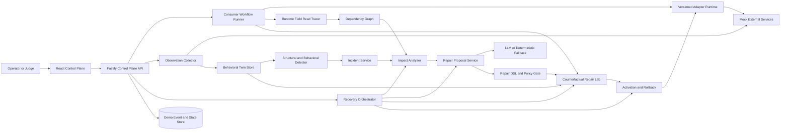
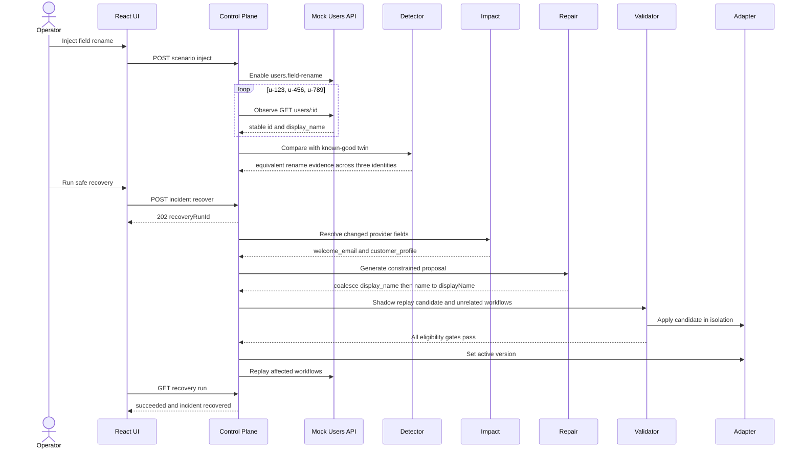

# DriftGuard Product Requirements Document

## Document control

| Item | Value |
|---|---|
| Project | DriftGuard |
| Hackathon track | PS 3 Resilient Infrastructure |
| Challenge | The Internet After the API |
| Build window | 24 hours |
| Product type | Full stack resilience control plane and demonstration application |
| Status | Build ready PRD |
| Primary audience | Product, engineering, design, QA, and hackathon judges |

## 1. Executive summary

DriftGuard is a self-healing integration control plane for software that depends on APIs and services it does not control. It observes a dependency's real behavior, builds an executable behavioral twin from known-good interactions, detects structural and behavioral drift, traces the blast radius to affected application workflows, proposes a constrained compatibility adapter, and proves that the repair is safe before activation.

The 24-hour prototype will demonstrate one complete recovery loop rather than a broad but shallow monitoring platform:

`inject change -> observe -> detect -> explain -> trace impact -> propose -> shadow validate -> activate -> replay -> recover`

The main demonstration uses a Users API that changes `name` to `display_name`. DriftGuard must identify the change from live responses, show which workflows are affected, produce a structured field-mapping proposal, validate it against recorded traffic and workflow invariants, activate a versioned adapter, and prove that the workflows recover. A second scenario changes meaning without changing JSON shape; DriftGuard must detect conflicting behavioral evidence and refuse automatic repair.

The product's differentiator is not merely using AI to write a patch. DriftGuard treats the AI as a hypothesis generator and uses deterministic evidence to accept or reject its proposal. Its behavioral twin combines observed fingerprints, active semantic probes, runtime field-level dependency tracing, and counterfactual replay. This allows the system to explain both what changed and why a proposed adaptation preserves the application's intended behavior.

## 2. Problem statement

Modern applications depend on third-party APIs, SDKs, webhooks, MCP servers, and hosted services. These dependencies can change without warning in ways that remain syntactically valid:

- A response field is renamed or moved.
- A default value or sort order changes.
- Pagination moves from page numbers to cursors.
- Error envelopes or status codes change.
- Rate limits tighten or retry guidance changes.
- A field keeps the same name and type but changes business meaning.
- A provider becomes unavailable or intermittently degraded.

Schema validation and uptime monitoring catch only part of this problem. They generally cannot show which workflows rely on the changed behavior, whether a mapping preserves meaning, or whether a generated repair is safe to activate.

DriftGuard addresses that gap by turning dependency behavior into an observable, testable, versioned contract derived from evidence rather than documentation alone.

## 3. Product vision

Applications should be able to survive routine dependency drift without silently corrupting behavior or requiring emergency integration rewrites. DriftGuard will act as an immune layer at dependency boundaries: it remembers healthy behavior, recognizes meaningful deviations, contains the blast radius, tests a compatible response, and escalates uncertainty instead of guessing.

### Product promise

When an external dependency changes, DriftGuard will answer five questions with evidence:

1. What behavior changed?
2. Which application workflows are affected?
3. What is the smallest permitted compatibility adaptation?
4. Does that adaptation preserve the application's expected outcomes?
5. Is the evidence strong enough for automatic activation, or is human review required?

## 4. Product principles

1. **Observed behavior outranks documentation.** Documentation is context, not proof of runtime behavior.
2. **AI proposes and deterministic gates decide.** Model confidence never substitutes for validation.
3. **Meaning matters more than valid JSON.** Domain invariants and active probes detect changes that schema diffs miss.
4. **Repair the boundary, not the whole application.** Adaptation occurs in a constrained, versioned compatibility layer.
5. **Prefer the smallest safe change.** A field mapping is better than unrestricted generated code.
6. **Uncertainty is a valid result.** Ambiguous or high-risk changes must be held for review.
7. **Every action is reversible and explainable.** Preserve the last-known-good adapter and an evidence trail.
8. **The demo must be real and repeatable.** No UI state may claim a successful test that the backend did not execute.

### 4.1 Settled implementation decisions

These decisions are binding for the 24-hour build and resolve earlier design ambiguity:

- Recovery is operator-triggered with `POST /api/incidents/:id/recover`, then fully orchestrated by the backend. The React app polls a `RecoveryRun`; it never chains recovery stages itself.
- P0 adapter operations are only `rename` and `coalesce`. `copy`, `default`, `enum_map`, and `cast` are P1 or later.
- Automatic activation is allowed only when every eligibility gate in FR-REP-07 passes. Human approval never bypasses deterministic validation.
- Rename evidence uses three stable user identities with distinct names. The preferred compatibility proposal is `coalesce [display_name, name] -> displayName`.
- A post-activation replay failure automatically restores the parent adapter, retains the failed evidence, and moves the incident to `rolled_back`.
- Reset archives the completed session, clears active demo state, restores adapter v1 and provider defaults, and starts a fresh session with no baseline.
- The deterministic repair model is the required P0 path. A live model implementation is optional and must use the same `RepairModel` contract.
- The P0 interface is an evidence-first operational workspace: solid surfaces, clear typography, a three-column impact trace, and restrained state-transition motion.

## 5. Unique product concept

### 5.1 The DriftGuard behavioral twin

For each observed endpoint, DriftGuard maintains a lightweight executable behavioral twin rather than a static schema. The twin contains:

- Response shape and type distributions.
- Field presence, null, and value-pattern statistics.
- Status-code and error-envelope behavior.
- Pagination and ordering behavior.
- Relevant latency and rate-limit signals.
- Known request-response examples.
- Domain invariants and active probe results.
- Versioned provider-to-canonical adapter rules.

This model is intentionally bounded. The prototype does not claim to infer arbitrary semantics from passive traffic.

### 5.2 Runtime blast-radius tracing

Instead of relying only on a manually drawn architecture diagram, workflow tests run against instrumented canonical objects. A JavaScript `Proxy` records which canonical fields each workflow actually reads. DriftGuard stores edges such as:

`welcome_email -> user.displayName`

`customer_profile -> user.displayName`

`delivery_estimate -> shipment.deliveryDays`

When provider behavior changes, DriftGuard follows the chain from changed provider behavior to the canonical adapter and then to workflows that consumed the canonical fields. This produces a field-level impact graph with fewer false positives than service-level dependency maps.

### 5.3 Semantic canaries

DriftGuard can run safe, predefined metamorphic probes that distinguish behavior with identical JSON schemas. For the delivery-days scenario, carefully selected dates around weekends expose whether `delivery_days` means calendar days or business days. The probe oracle is deterministic; the AI may suggest which approved probe to run but cannot invent or execute unrestricted requests.

### 5.4 Counterfactual repair lab

Before activation, DriftGuard replays captured requests and expected workflow outcomes through the candidate adapter in a shadow environment. It compares canonical outputs, invariants, side-effect plans, and workflow results against the last-known-good baseline. This is a counterfactual test: "If this adapter had been active, would the application still have behaved correctly?"

### 5.5 Evidence passport

Every incident produces a compact, exportable evidence passport containing the before/after behavior, detected changes, affected workflows, proposed adapter, validation results, decision, and rollback pointer. This makes the demo explainable and creates an audit artifact suitable for real engineering teams.

### Why this is different

Most AI repair demos stop at generating a plausible patch. DriftGuard makes the proposal try to survive falsification. Its differentiator is the combination of active behavioral evidence, actual workflow read tracing, constrained repair operations, and counterfactual validation. The AI is useful, but safety and credibility do not depend on trusting it.

## 6. Target users and jobs to be done

### Primary users

- Platform and site reliability engineers responsible for dependency health.
- Backend engineers who own integrations and adapters.
- Application teams whose workflows rely on external services.
- Incident responders who need fast evidence and a reversible mitigation.

### Jobs to be done

- When a dependency changes unexpectedly, tell me what changed without requiring complete provider documentation.
- Show me exactly which workflows and canonical fields are exposed to the change.
- Give me the smallest plausible compatibility repair with supporting evidence.
- Prove the repair against known workflows before it reaches active traffic.
- Stop and request review when meaning is unclear or side effects are risky.
- Let me activate, observe, and roll back a repair from one control plane.

## 7. Goals, non-goals, and success measures

### 7.1 Goals for the hackathon build

- Deliver a working React frontend and TypeScript backend.
- Simulate at least three external services with repeatable drift modes.
- Complete the field-rename recovery loop end to end.
- Detect at least one behavioral change that a JSON schema diff alone cannot prove.
- Build a field-level workflow impact map from runtime reads.
- Generate or deterministically fall back to a schema-valid repair proposal.
- Validate candidate adapters before activation.
- Refuse unsafe or semantically ambiguous automatic repair.
- Support one-click reset and a reproducible three-minute demo.

### 7.2 Non-goals for the 24-hour build

- Arbitrary source-code generation or autonomous repository modification.
- Production traffic interception, multi-tenant isolation, or distributed scaling.
- Real payment execution or replay of non-idempotent operations.
- General semantic inference for unknown domains.
- Kubernetes, a service mesh, or a complex event platform.
- Integration with real third-party providers.
- A generalized agent framework or multi-agent orchestration system.

### 7.3 Demo success measures

| Measure | Target |
|---|---:|
| Primary scenario detection | 100 percent across five consecutive local runs |
| Correct impacted workflows for field rename | 100 percent in defined fixtures |
| Unrelated workflow false positives | 0 in defined fixtures |
| Unsafe semantic repair auto-activations | 0 |
| Candidate repair validation before activation | 100 percent |
| End-to-end local recovery time excluding optional live LLM latency | Under 15 seconds |
| Demo reset time | Under 5 seconds |
| Consecutive complete demo rehearsals before submission | At least 2 |

These are acceptance targets, not claims about results that have not yet been measured.

## 8. Scope and priorities

### P0 required

- One React control-plane dashboard.
- One Fastify control-plane API.
- One mock-provider server exposing Users, Inventory, and Shipping endpoints.
- Named consumer workflows executed by the backend.
- Baseline capture and behavioral fingerprint generation.
- Structural diff for added, removed, moved, or type-changed fields.
- Behavioral comparison for pagination or semantic-canary output.
- Runtime field-read dependency tracing.
- Incident creation with before/after evidence.
- Provider-neutral structured repair proposal through a `RepairModel` interface.
- Deterministic fallback proposal for the field-rename demo.
- Strict P0 repair DSL limited to `rename` and `coalesce`.
- Shadow replay and workflow invariant validation.
- Operator-triggered, backend-orchestrated recovery runs.
- Versioned activation, post-activation replay, and automatic rollback on replay failure.
- Ambiguous semantic scenario that is held for review.
- Reset endpoint and scripted seed data.

### P1 if P0 is stable by hour 16

- Cursor-pagination adapter and exactly-once item validation.
- Rate-limit detection with bounded idempotency-aware retry policy.
- Optional interactive impact graph after the three-column trace is stable.
- Evidence passport export as JSON.
- Server-sent events for live stage updates.

### P2 future work

- Real reverse-proxy or SDK instrumentation.
- Webhook and MCP behavior adapters.
- Statistical baselines across larger traffic volumes.
- Production canaries, staged rollout, and approval integrations.
- Organization-level policy and multi-tenant data isolation.

## 9. Core user journeys

### 9.1 Capture a healthy baseline

1. The operator selects **Capture baseline**.
2. The control plane calls each enabled mock provider with deterministic fixture requests.
3. The observer records responses, error behavior, and approved probe results.
4. Consumer workflows execute through the active adapters.
5. Runtime tracing records workflow-to-canonical-field reads.
6. DriftGuard saves a versioned behavioral twin and displays a healthy state.

### 9.2 Recover from a field rename

1. The operator injects `users.field-rename`.
2. The mock Users API returns `display_name` instead of `name`.
3. The `welcome_email` and `customer_profile` workflows fail their required-field invariants.
4. The observer captures the changed response.
5. The detector reports `name` removed and `display_name` added with matching value evidence.
6. The operator selects **Run safe recovery**. The API creates a `RecoveryRun` and returns `202 Accepted`.
7. The backend identifies impact, proposes the constrained mapping, runs shadow validation, and evaluates every automatic-activation gate.
8. If eligible, the backend activates the exact validated patch and replays affected workflows.
9. The UI polls the run and renders backend-confirmed stages. Successful replay moves the incident to `recovered`; a failed replay rolls back automatically.

### 9.3 Refuse an ambiguous semantic repair

1. The operator injects `shipping.business-days`.
2. The response schema remains unchanged.
3. `GET /shipping/estimate?ship_date=2026-10-09&delivery_days=3` returns `2026-10-14` instead of the baseline `2026-10-12`, violating the calendar-day invariant without changing shape.
4. DriftGuard shows the affected `delivery_estimate` workflow.
5. The repair proposal lacks evidence for a lossless conversion or exceeds the allowed risk threshold.
6. Policy sets the incident to `review_required`; no adapter is activated.
7. The last-known-good adapter remains available, and the UI explains the missing evidence.

## 10. Functional requirements

Priority definitions: P0 is required for the demo, P1 is optional after P0 is stable, and P2 is future work.

### 10.1 Scenario and provider simulation

| ID | Priority | Requirement | Acceptance criterion |
|---|---|---|---|
| FR-SIM-01 | P0 | The system shall expose Users, Inventory, and Shipping mock services over HTTP. | All three respond to seeded requests from the consumer backend. |
| FR-SIM-02 | P0 | The system shall activate a named drift scenario without source edits or server restarts. | A UI action or API call changes subsequent provider responses. |
| FR-SIM-03 | P0 | The system shall support `users.field-rename` and `shipping.business-days`. | Both scenarios are repeatable after reset. |
| FR-SIM-04 | P0 | Reset shall restore provider scenarios and adapter v1, clear active observations, incidents, patches, workflow runs, and recovery runs, archive the completed session audit, and start a fresh empty session. | After reset there is no current baseline; the next legal action is **Capture baseline**, while the prior session remains read-only. |
| FR-SIM-05 | P1 | The system shall support `inventory.cursor-pagination`. | The provider switches from page-number to cursor behavior. |
| FR-SIM-06 | P1 | The system shall support a rate-limit scenario with `429` and optional `Retry-After`. | Retry signals appear in observations and no payment-like action is blindly retried. |

### 10.2 Observation and behavioral twin

| ID | Priority | Requirement | Acceptance criterion |
|---|---|---|---|
| FR-OBS-01 | P0 | The system shall capture a versioned known-good baseline from real HTTP responses. | Stored observations contain request metadata, response status, headers, body, time, and provider version label. |
| FR-OBS-02 | P0 | The system shall normalize volatile values before comparison. | Configured timestamps and request IDs do not create false drift incidents. |
| FR-OBS-03 | P0 | The system shall compute response shape, field presence, types, nulls, and value fingerprints. | The baseline endpoint returns a behavioral fingerprint for each observed route. |
| FR-OBS-04 | P0 | The system shall record approved semantic-canary results. | `ship_date=2026-10-09&delivery_days=3` records baseline date `2026-10-12`; the drift scenario returns `2026-10-14` with the same schema. |
| FR-OBS-05 | P0 | The system shall keep raw and normalized evidence distinct. | Incident evidence can display both forms without modifying the raw capture. |
| FR-OBS-06 | P1 | The system shall capture pagination, ordering, latency, and rate-limit signals. | Behavioral twin includes those dimensions when the scenario is enabled. |

### 10.3 Change detection

| ID | Priority | Requirement | Acceptance criterion |
|---|---|---|---|
| FR-DET-01 | P0 | The detector shall run without an LLM. | Disconnecting the LLM does not stop baseline comparison or incident creation. |
| FR-DET-02 | P0 | The detector shall classify added, removed, moved, and type-changed fields. | `name -> display_name` produces one removed-field and one added-field finding across three stable identities with distinct values. |
| FR-DET-03 | P0 | The detector shall attach before/after evidence and a deterministic fingerprint to each finding. | Re-running the same scenario does not create duplicate active incidents. |
| FR-DET-04 | P0 | The detector shall compare semantic-canary output to the baseline. | The business-days scenario produces a behavioral finding despite an unchanged schema. |
| FR-DET-05 | P0 | The detector shall grade evidence separately from repair confidence. | A high-likelihood rename can still fail repair validation. |
| FR-DET-06 | P1 | The detector shall classify pagination and rate-limit behavior changes. | Optional scenarios create the correct change type. |

### 10.4 Workflow dependency and impact analysis

| ID | Priority | Requirement | Acceptance criterion |
|---|---|---|---|
| FR-IMP-01 | P0 | The system shall define named consumer workflows with explicit inputs and invariants. | `CanonicalUser` is `{ id: string, displayName: string }`; `welcome_email` emits a stubbed intent whose nonempty `recipientName` equals baseline, and `customer_profile` emits `{ id, displayName }` deep-equal to baseline. |
| FR-IMP-02 | P0 | The system shall record canonical fields read during workflow execution. | Baseline runs persist workflow-to-field dependency edges. |
| FR-IMP-03 | P0 | The impact analyzer shall connect provider changes through adapter mappings to canonical fields and workflows. | User rename identifies `welcome_email` and `customer_profile`. |
| FR-IMP-04 | P0 | The impact report shall exclude unrelated workflows in the defined fixtures. | `inventory_sync` and `delivery_estimate` are not flagged for the user rename. |
| FR-IMP-05 | P0 | The UI shall display why each workflow is considered affected. | Each edge shows provider behavior, canonical field, and workflow invariant. |

### 10.5 Repair proposal and policy

| ID | Priority | Requirement | Acceptance criterion |
|---|---|---|---|
| FR-REP-01 | P0 | The system shall create a structured evidence bundle for repair generation. | Bundle includes incident, observations, affected workflows, canonical contract, allowed operations, fixtures, and invariants. |
| FR-REP-02 | P0 | The provider-neutral `RepairModel` interface shall return only a typed repair proposal. | Invalid JSON, unknown fields, and unsupported operations are rejected regardless of proposal source. |
| FR-REP-03 | P0 | The repair DSL shall allow only `rename` and `coalesce`. | `copy`, `default`, `enum_map`, `cast`, arbitrary code, shell commands, and network calls are rejected. |
| FR-REP-04 | P0 | The system shall provide a clearly labelled deterministic repair model for the field-rename scenario; a live model is optional. | The full demo remains operational without model credentials or connectivity, and every proposal exposes its source. |
| FR-REP-05 | P0 | Policy shall evaluate evidence strength, operation risk, endpoint side effects, and required validation. | Ambiguous semantic changes require human review. |
| FR-REP-06 | P0 | The proposal shall expose evidence, uncertainties, validation plan, and approval recommendation. | All fields are visible in the incident panel. |
| FR-REP-07 | P0 | Automatic activation shall require every eligibility gate: read-only endpoint; structural rather than semantic drift; only `rename` or `coalesce`; value equivalence across known identities; no proposal uncertainty; replay-safe affected workflows; passing canonical schema and all affected workflow invariants; validation hash equal to candidate patch hash; and no unrelated workflow regression. | Removing any single gate prevents activation. Semantic, conflicting, high-risk, or insufficient evidence yields `review_required`; invalid proposals or failed deterministic validation yield `rejected`. |
| FR-REP-08 | P0 | Human review shall not waive a failed or missing deterministic check. | A `review_required` incident can resume only after new evidence or a revised proposal passes all required validation. |

### 10.6 Validation, activation, and rollback

| ID | Priority | Requirement | Acceptance criterion |
|---|---|---|---|
| FR-VAL-01 | P0 | The validator shall apply the candidate adapter in isolation. | Active behavior is unchanged during validation. |
| FR-VAL-02 | P0 | The validator shall replay captured provider responses through the candidate adapter. | Canonical output matches required baseline semantics for the rename fixture. |
| FR-VAL-03 | P0 | The validator shall replay affected workflows and evaluate their invariants. | Both user workflows pass before a patch becomes activatable. |
| FR-VAL-04 | P0 | Validation shall fail when required fields are missing, types are wrong, or invariants fail. | A deliberately invalid `display_name -> id` mapping is rejected. |
| FR-VAL-05 | P0 | Activation shall accept only a patch with a passing validation record for the exact candidate patch hash. | Direct activation of an unvalidated or modified patch returns a conflict error. |
| FR-VAL-06 | P0 | Activation shall preserve the prior adapter as last known good. | Rollback restores the previous adapter version and workflows can be replayed. |
| FR-VAL-07 | P0 | The system shall never replay non-idempotent external side effects during shadow validation. | Side-effecting steps produce recorded intents or stubs only. |
| FR-VAL-08 | P0 | A failed post-activation workflow replay shall automatically roll back the parent adapter and preserve the failed patch and evidence. | The incident becomes `rolled_back`; audit events contain activation and rollback, and the parent adapter is active. |
| FR-VAL-09 | P0 | Infrastructure failures shall fail the `RecoveryRun` without inventing an incident transition. | The incident remains in its last valid state and the run exposes a safe failure reason. |

### 10.7 Recovery orchestration

| ID | Priority | Requirement | Acceptance criterion |
|---|---|---|---|
| FR-REC-01 | P0 | `POST /api/incidents/:id/recover` shall create one backend-owned recovery execution and return `202` with `recoveryRunId` and `incidentId`. | A concurrent request for the same incident returns `409 RECOVERY_ALREADY_RUNNING` with the active `recoveryRunId` in safe error details. |
| FR-REC-02 | P0 | A `RecoveryRun` shall expose status `queued | running | succeeded | failed` and stage `impact | proposing | validating | activating | replaying | rolling_back`, with timestamps and an optional failure reason. | `GET /api/recovery-runs/:recoveryRunId` is sufficient for UI polling. |
| FR-REC-03 | P0 | The backend orchestrator shall own impact, proposal, validation, activation, replay, and rollback sequencing. | The frontend calls one recovery command and never derives or advances backend state. |
| FR-REC-04 | P0 | Guided individual stage actions shall remain available for inspection and rehearsal. | Each action uses the same domain services, state guards, evidence, and audit events as automatic recovery. |

### 10.8 Frontend control plane

| ID | Priority | Requirement | Acceptance criterion |
|---|---|---|---|
| FR-UI-01 | P0 | The dashboard shall show provider health, active scenarios, and baseline status. | Status is loaded from the backend, not hard-coded. |
| FR-UI-02 | P0 | The dashboard shall expose **Run safe recovery** plus guided capture, inject, observe, propose, validate, activate, rollback, replay, and reset actions. | Recovery starts once, polls its run, and every action shows backend-confirmed loading, success, or error state. |
| FR-UI-03 | P0 | The incident view shall show before/after evidence and change classification. | A judge can see `name` removed and `display_name` added. |
| FR-UI-04 | P0 | The impact view shall show provider-to-canonical-to-workflow relationships. | Affected and unaffected workflows are visually distinguishable. |
| FR-UI-05 | P0 | The repair view shall show the constrained adapter diff and validation results. | No patch is presented as active until the backend confirms activation. |
| FR-UI-06 | P0 | The UI shall distinguish `detected`, `proposed`, `validating`, `validated`, `active`, `review_required`, `rejected`, `rolled_back`, and `recovered`. | State labels match the incident state machine. |
| FR-UI-07 | P0 | The UI shall provide a guided demo mode. | The next legal action is prominent and illegal actions are disabled with an explanation. |
| FR-UI-08 | P1 | The dashboard shall update stages through server-sent events. | Timeline progresses without manual refresh. |
| FR-UI-09 | P0 | The dashboard shall use an evidence-first operational layout and restrained visual language. | Solid surfaces, clear type hierarchy, visible focus, three-column impact trace, no decorative gradients, glass effects, neon glow, bento collage, amorphous blobs, excessive nested cards, or continuous animation. |

### 10.9 Audit and operations

| ID | Priority | Requirement | Acceptance criterion |
|---|---|---|---|
| FR-OPS-01 | P0 | Every recovery run, proposal, validation, activation, replay, rollback, and reset shall create an audit event. | Incident timeline is derived from stored events. |
| FR-OPS-02 | P0 | The system shall expose health endpoints for the control plane and mock providers. | Startup script can verify readiness. |
| FR-OPS-03 | P0 | The repository shall include example environment variables and one-command local startup. | A new team member can start the demo from the README. |
| FR-OPS-04 | P1 | The system shall export the incident evidence passport as JSON. | Downloaded content matches the selected incident and patch versions. |

## 11. Non-functional requirements

| ID | Category | Requirement | Target or verification |
|---|---|---|---|
| NFR-01 | Safety | No model output may execute as arbitrary code. | Only schema-validated DSL operations reach the adapter runtime. |
| NFR-02 | Reliability | The primary demo must not require an external LLM to finish. | Deterministic fallback is covered by integration tests. |
| NFR-03 | Determinism | Reset followed by baseline capture must produce equivalent fingerprints. | Stable fixture test passes across repeated runs. |
| NFR-04 | Performance | Local detect-to-incident processing shall complete quickly enough for a live demo. | P95 under 2 seconds for seeded scenarios on a developer laptop, excluding LLM latency. |
| NFR-05 | Recovery | Rollback shall restore last-known-good behavior. | Integration test activates a patch, rolls back, and verifies the prior version. |
| NFR-06 | Explainability | Every automated decision shall link to evidence and policy results. | UI and API expose reason codes, not only a confidence number. |
| NFR-07 | Availability | A missing model key shall disable only optional live proposal generation. | The required deterministic `RepairModel`, detection, impact, validation, recovery, and reset all pass offline. |
| NFR-08 | Security | Secrets shall remain server-side and outside logs, responses, and committed files. | `.env.example` contains placeholders only; log sanitizer test covers configured headers. |
| NFR-09 | Privacy | Captured headers and bodies shall pass through configurable redaction before persistence. | Authorization, cookies, and configured fields are redacted. |
| NFR-10 | Accessibility | The primary UI flow shall be keyboard usable with visible focus and semantic status text. | Manual keyboard pass and automated accessibility smoke test. |
| NFR-11 | Compatibility | The demo shall run in current Chromium-based browsers and on one local Node runtime. | Smoke test in the presentation environment. |
| NFR-12 | Maintainability | Detection, impact, repair, validation, and adapters shall have package boundaries and typed contracts. | No frontend import reaches backend internals; shared types come from `packages/contracts`. |
| NFR-13 | Observability | Each run shall carry a correlation ID across observation, incident, patch, and workflow replay logs. | A complete scenario can be filtered by one ID. |
| NFR-14 | Auditability | Audit events shall be append-only within each demo session. | Reset closes and archives the current session with a reset event, then creates a clean session. |
| NFR-15 | Testability | Core logic shall be callable without HTTP or UI. | Unit tests invoke detector, impact, policy, and validator as pure services. |
| NFR-16 | Demo resilience | The full demo shall reset without process restarts or source changes. | Two consecutive three-minute rehearsals complete successfully. |
| NFR-17 | State integrity | Execution progress and incident truth shall remain separate. | An infrastructure failure marks only its `RecoveryRun` failed; the incident retains its last valid domain state. |
| NFR-18 | Visual clarity | The primary screen shall optimize evidence comparison and operational decisions over decoration. | Review confirms one clear action hierarchy, solid surfaces, compact density, and motion limited to user actions or state changes with reduced-motion support. |

## 12. System architecture

### 12.1 Architecture decision

Use a TypeScript monorepo with three runnable applications and focused internal packages. This preserves real HTTP boundaries without spending the sprint on microservice orchestration.

- **Web app:** React, Vite, TypeScript, and Tailwind CSS. Start with a three-column impact trace; add React Flow only if it materially improves comprehension after P0 is stable.
- **Control-plane API:** Fastify and TypeScript. Owns observation, detection orchestration, workflows, incidents, repair, validation, activation, and audit.
- **Mock-provider server:** Fastify and TypeScript. Hosts independent route plugins for Users, Inventory, and Shipping with scenario toggles.
- **Contracts and validation:** Zod schemas shared between frontend, backend, and test fixtures.
- **Persistence:** Lowdb JSON store behind repository interfaces for zero-setup demo persistence. In-memory repositories are used by unit tests.
- **Testing:** Vitest for unit and integration tests; Playwright for one golden-path browser test if time permits.
- **AI:** Provider-neutral `RepairModel` interface with the deterministic implementation required for P0 and a live implementation only if credentials and schedule allow.

### 12.2 Logical architecture



### 12.3 End-to-end recovery sequence



### 12.4 Safety boundary

The model is outside the trusted execution boundary. Its output becomes data, not code. The trusted backend must:

1. Parse the response into a Zod schema.
2. Reject unsupported fields or operations.
3. Resolve all paths against known provider and canonical contracts.
4. Evaluate policy and risk rules.
5. Execute the candidate only in the adapter interpreter.
6. Validate against the same immutable patch hash that may later be activated.

## 13. Domain model

| Entity | Purpose | Key fields |
|---|---|---|
| Provider | External dependency under observation | `id`, `name`, `baseUrl`, `riskClass`, `enabled` |
| Endpoint | Observable provider operation | `id`, `providerId`, `method`, `path`, `idempotency`, `probePolicy` |
| Observation | Raw evidence from one request | `id`, `endpointId`, `request`, `response`, `capturedAt`, `scenarioId` |
| BehavioralTwin | Versioned normalized behavior | `id`, `endpointId`, `version`, `fingerprint`, `examples`, `invariants` |
| ChangeFinding | One detected difference | `id`, `type`, `path`, `before`, `after`, `evidenceStrength` |
| Incident | Lifecycle wrapper around related findings | `id`, `providerId`, `status`, `severity`, `fingerprint`, `createdAt` |
| RecoveryRun | Backend-owned execution progress separate from incident truth | `id`, `incidentId`, `status`, `stage`, `startedAt`, `finishedAt`, `failureReason` |
| Workflow | Named consumer behavior | `id`, `name`, `riskClass`, `invariants`, `sideEffectPolicy` |
| DependencyEdge | Observed workflow dependency | `workflowId`, `canonicalPath`, `readCount`, `lastSeenAt` |
| AdapterVersion | Provider-to-canonical mapping | `id`, `providerId`, `version`, `operations`, `state`, `parentId` |
| RepairProposal | Candidate adaptation and rationale | `id`, `incidentId`, `adapterVersionId`, `source`, `evidence`, `uncertainties` |
| ValidationRun | Immutable validation result | `id`, `patchHash`, `checks`, `result`, `startedAt`, `finishedAt` |
| AuditEvent | Append-only event timeline | `id`, `correlationId`, `type`, `actor`, `payload`, `createdAt` |

## 14. Incident state machine

```text
detected
  -> proposed
  -> validating
  -> validated
  -> active
  -> recovered

detected | proposed | validating
  -> review_required
  -> rejected

review_required
  -> proposed

active | recovered
  -> rolled_back
```

Rules:

- `active` requires a passing `ValidationRun` whose patch hash equals the activated patch hash.
- `review_required` has no approval-only path to `active`; it can resume only when new evidence or a revised proposal passes every required check and eligibility gate.
- `rejected` proposals remain visible in the audit history.
- `rolled_back` restores a recorded parent adapter version rather than synthesizing a new mapping.
- `recovered` requires a successful post-activation workflow replay.
- A failed post-activation replay records activation and rollback, restores the parent adapter, and ends at `rolled_back`.
- Infrastructure failure changes `RecoveryRun.status` to `failed` but does not manufacture an incident-state transition.

Recovery execution uses a separate state model:

```text
status: queued -> running -> succeeded | failed
stage:  impact -> proposing -> validating -> activating -> replaying
                                                     -> rolling_back
```

If post-activation replay fails, the run finishes with `status=failed` and `stage=rolling_back` after the parent adapter is restored; the incident finishes at `rolled_back`.

Demo-session baseline state is separate from both models:

```text
awaiting_baseline -> healthy
reset -> archive current session -> create new awaiting_baseline session
```

Reset archives and removes active incident and execution state; it does not transition an incident to `awaiting_baseline`.

## 15. Constrained repair DSL

The adapter runtime interprets declarative operations. It does not evaluate generated JavaScript.

```json
{
  "proposalVersion": "1",
  "incidentId": "inc_users_rename_001",
  "summary": "Map the renamed provider field to the canonical display name",
  "operations": [
    {
      "op": "coalesce",
      "from": ["$.display_name", "$.name"],
      "to": "$.displayName"
    }
  ],
  "evidenceRefs": [
    "obs_baseline_users_001",
    "obs_current_users_002"
  ],
  "uncertainties": [],
  "requiredChecks": [
    "canonical-user-schema",
    "welcome-email-invariant",
    "customer-profile-invariant"
  ],
  "recommendation": "eligible_after_validation"
}
```

### Allowed P0 operations

- `rename`: move a value from a known source path to a known target path.
- `coalesce`: choose the first present value from an ordered path list.

Deferred to P1 or later: `copy`, `default`, `enum_map`, and bounded `cast`.

### Explicitly forbidden

- Arbitrary JavaScript, Python, shell commands, or templates with evaluation.
- New outbound network calls.
- File-system access.
- Dynamic package installation.
- Unbounded loops or recursion.
- Mutation of requests for non-idempotent operations in P0.
- A semantic conversion without a deterministic oracle. Human approval cannot waive this constraint or any failed validation.

## 16. API requirements

Every response exposes `X-Correlation-Id`. Ordinary completed mutations include their `auditEventId` in the response body. Recovery creation is the intentional exception because it is asynchronous: it returns exactly `202 { recoveryRunId, incidentId }`, while its creation and later stage audit events are available through the run and incident timeline. Error responses use this shared envelope:

```json
{
  "error": {
    "code": "PATCH_NOT_VALIDATED",
    "message": "The candidate patch has no passing validation for its current hash.",
    "details": {},
    "correlationId": "corr_01..."
  }
}
```

`code` is stable and machine-readable, `message` is safe for operators, `details` contains bounded non-secret context, and `correlationId` connects UI, audit, and logs.

| Method | Endpoint | Purpose |
|---|---|---|
| `GET` | `/api/health` | Control-plane readiness |
| `GET` | `/api/demo/state` | Complete UI projection for the active demo |
| `POST` | `/api/demo/reset` | Restore deterministic initial state |
| `POST` | `/api/baselines/capture` | Observe providers, run workflows, and save behavioral twins |
| `GET` | `/api/providers` | List provider health and active scenarios |
| `POST` | `/api/scenarios/:scenarioId/inject` | Activate a mock-provider change |
| `POST` | `/api/observations/run` | Observe enabled endpoints and detect drift |
| `GET` | `/api/incidents` | List incidents |
| `GET` | `/api/incidents/:incidentId` | Fetch evidence, impact, repair, and timeline |
| `POST` | `/api/incidents/:incidentId/analyze-impact` | Resolve affected fields and workflows |
| `POST` | `/api/incidents/:incidentId/propose-repair` | Request a typed proposal or deterministic fallback |
| `POST` | `/api/incidents/:id/recover` | Start backend-orchestrated safe recovery; returns `202 { recoveryRunId, incidentId }` |
| `GET` | `/api/recovery-runs/:recoveryRunId` | Poll recovery status, stage, timestamps, and failure reason |
| `POST` | `/api/patches/:patchId/validate` | Run isolated replay and invariants |
| `POST` | `/api/patches/:patchId/activate` | Activate the exact validated version |
| `POST` | `/api/patches/:patchId/rollback` | Restore its last-known-good parent |
| `POST` | `/api/workflows/:workflowId/replay` | Execute a safe consumer workflow |
| `GET` | `/api/incidents/:incidentId/passport` | P1 evidence passport export |
| `GET` | `/api/events` | P1 server-sent event stream |

Mock-provider endpoints are exposed separately under the mock-provider process:

| Method | Endpoint | Baseline behavior |
|---|---|---|
| `GET` | `/users/:id` | `{ id, name }` |
| `GET` | `/inventory` | Page-number response with stable ordering |
| `GET` | `/shipping/estimate` | Calendar-day estimate |
| `POST` | `/__control/scenarios/:scenarioId` | Activate a seeded drift scenario |
| `POST` | `/__control/reset` | Restore mock-provider state |
| `GET` | `/health` | Mock-provider readiness |

## 17. Frontend product specification

### 17.1 Information architecture

Build one evidence-first operational workspace with four synchronized regions rather than a route maze or a collage of interchangeable cards:

1. **Dependency rail:** compact provider health, baseline version, and scenario controls.
2. **Incident workspace:** before/after evidence and classified changes.
3. **Impact trace:** three aligned columns for provider behavior -> canonical field -> affected workflows, with explicit connecting paths.
4. **Repair lab:** proposal, adapter diff, validation checks, activation, replay, and rollback.

A compact event timeline spans the bottom or right edge. On smaller screens, the columns stack in causal order. Use solid surfaces, spacing, borders, and typography to create hierarchy. Do not use decorative gradients, glass or blur effects, neon glow, bento-style tiles, amorphous background shapes, excessive card nesting, or ornamental charts.

### 17.2 Guided demo behavior

- The primary action button advances the legal next step.
- **Run safe recovery** starts one backend recovery run; the UI polls it and renders its backend-confirmed stage.
- All steps remain individually callable for engineering inspection.
- Completed steps show measured backend evidence and duration.
- A failed step remains visible with a reason and retry option.
- Seeded or fallback output is labelled accurately.
- The ambiguous scenario uses a visibly different hold state, not a generic red error.
- The dashboard never fabricates percentages, pass counts, or confidence values.
- Motion is reserved for a user-triggered transition or a meaningful state change, never continuous decoration, and respects reduced-motion preferences.

### 17.3 Key UI components

- `ProviderStatusRail`
- `ScenarioLauncher`
- `DemoStepController`
- `ObservationDiff`
- `IncidentStatusBadge`
- `ImpactTrace`
- `RecoveryRunProgress`
- `WorkflowResultList`
- `RepairProposalPanel`
- `AdapterDiff`
- `ValidationChecklist`
- `AuditTimeline`
- `RollbackDialog`
- `ResetDemoButton`

## 18. Repository and file structure

The following structure is the target for implementation. It keeps the external-service boundary real while allowing the team to share contracts and tests.

```text
CONTINGENCY/
├── apps/
│   ├── web/
│   │   ├── src/
│   │   │   ├── app/
│   │   │   │   ├── App.tsx
│   │   │   │   ├── router.tsx
│   │   │   │   └── providers.tsx
│   │   │   ├── components/
│   │   │   │   ├── dependency-rail/
│   │   │   │   ├── incident-workspace/
│   │   │   │   ├── impact-trace/
│   │   │   │   ├── repair-lab/
│   │   │   │   └── timeline/
│   │   │   ├── features/
│   │   │   │   ├── demo-control/
│   │   │   │   ├── incidents/
│   │   │   │   ├── providers/
│   │   │   │   ├── recovery-runs/
│   │   │   │   └── patches/
│   │   │   ├── lib/
│   │   │   │   ├── api-client.ts
│   │   │   │   ├── query-client.ts
│   │   │   │   └── formatters.ts
│   │   │   ├── styles/
│   │   │   └── main.tsx
│   │   ├── index.html
│   │   ├── package.json
│   │   └── vite.config.ts
│   ├── api/
│   │   ├── src/
│   │   │   ├── server.ts
│   │   │   ├── app.ts
│   │   │   ├── config.ts
│   │   │   ├── routes/
│   │   │   │   ├── baselines.ts
│   │   │   │   ├── demo.ts
│   │   │   │   ├── incidents.ts
│   │   │   │   ├── observations.ts
│   │   │   │   ├── patches.ts
│   │   │   │   ├── providers.ts
│   │   │   │   ├── recovery-runs.ts
│   │   │   │   └── workflows.ts
│   │   │   ├── services/
│   │   │   │   ├── baseline-service.ts
│   │   │   │   ├── incident-service.ts
│   │   │   │   ├── recovery-orchestrator.ts
│   │   │   │   └── scenario-service.ts
│   │   │   ├── workflows/
│   │   │   │   ├── welcome-email.ts
│   │   │   │   ├── customer-profile.ts
│   │   │   │   ├── inventory-sync.ts
│   │   │   │   └── delivery-estimate.ts
│   │   │   ├── repositories/
│   │   │   │   ├── interfaces.ts
│   │   │   │   ├── lowdb-repositories.ts
│   │   │   │   └── memory-repositories.ts
│   │   │   └── plugins/
│   │   │       ├── errors.ts
│   │   │       ├── logging.ts
│   │   │       └── request-context.ts
│   │   └── package.json
│   └── mock-providers/
│       ├── src/
│       │   ├── server.ts
│       │   ├── scenario-registry.ts
│       │   ├── state.ts
│       │   └── providers/
│       │       ├── users.ts
│       │       ├── inventory.ts
│       │       └── shipping.ts
│       └── package.json
├── packages/
│   ├── contracts/
│   │   └── src/
│   │       ├── adapter.ts
│   │       ├── api.ts
│   │       ├── behavior.ts
│   │       ├── incident.ts
│   │       ├── recovery-run.ts
│   │       ├── repair.ts
│   │       ├── validation.ts
│   │       └── workflow.ts
│   ├── observer/
│   │   └── src/
│   │       ├── collect.ts
│   │       ├── fingerprint.ts
│   │       ├── normalize.ts
│   │       └── redact.ts
│   ├── detector/
│   │   └── src/
│   │       ├── structural-diff.ts
│   │       ├── behavioral-diff.ts
│   │       ├── semantic-canaries.ts
│   │       └── classify.ts
│   ├── lineage/
│   │   └── src/
│   │       ├── field-read-proxy.ts
│   │       ├── dependency-graph.ts
│   │       └── impact-analyzer.ts
│   ├── adapter-runtime/
│   │   └── src/
│   │       ├── interpreter.ts
│   │       ├── operations.ts
│   │       ├── registry.ts
│   │       └── versioning.ts
│   ├── repair/
│   │   └── src/
│   │       ├── evidence-bundle.ts
│   │       ├── model-interface.ts
│   │       ├── live-model.ts              # optional after P0
│   │       ├── deterministic-fallback.ts
│   │       └── policy.ts
│   ├── validation/
│   │   └── src/
│   │       ├── replay-engine.ts
│   │       ├── invariant-runner.ts
│   │       ├── patch-hash.ts
│   │       └── validation-service.ts
│   └── test-kit/
│       └── src/
│           ├── builders.ts
│           ├── fake-clock.ts
│           └── fixtures.ts
├── fixtures/
│   ├── baselines/
│   ├── scenarios/
│   │   ├── users-field-rename.json
│   │   ├── shipping-business-days.json
│   │   └── inventory-cursor-pagination.json
│   ├── observations/
│   ├── workflows/
│   └── expected/
├── tests/
│   ├── integration/
│   │   ├── field-rename-recovery.test.ts
│   │   ├── recovery-run-state.test.ts
│   │   ├── ambiguous-semantics-hold.test.ts
│   │   ├── invalid-patch-rejection.test.ts
│   │   ├── offline-fallback.test.ts
│   │   ├── replay-failure-rollback.test.ts
│   │   └── rollback.test.ts
│   └── e2e/
│       └── golden-demo.spec.ts
├── data/
│   └── .gitkeep
├── scripts/
│   ├── demo-reset.ts
│   ├── demo-smoke.ts
│   └── wait-for-services.ts
├── docs/
│   ├── architecture.md
│   ├── demo-script.md
│   └── evidence-model.md
├── .env.example
├── .gitignore
├── package.json
├── pnpm-workspace.yaml
├── tsconfig.base.json
├── vitest.workspace.ts
├── README.md
└── DRIFTGUARD_PRD.md
```

### Package ownership rules

- `apps/*` may depend on `packages/*`.
- Core packages may depend on `packages/contracts` but not on applications.
- `packages/detector` must never depend on an LLM implementation.
- `packages/validation` may execute adapter DSL only through `packages/adapter-runtime`.
- The frontend uses API contracts from `packages/contracts` and never imports backend services.
- Mock-provider scenario state remains isolated from detector logic so the detector cannot "cheat" by reading the active scenario.

## 19. Demo scenarios and expected behavior

### Scenario A field rename and automatic recovery

**Known-good provider responses**

```json
[
  { "id": "u-123", "name": "Aarav" },
  { "id": "u-456", "name": "Meera" },
  { "id": "u-789", "name": "Kabir" }
]
```

**Changed provider responses**

```json
[
  { "id": "u-123", "display_name": "Aarav" },
  { "id": "u-456", "display_name": "Meera" },
  { "id": "u-789", "display_name": "Kabir" }
]
```

**Expected result**

- Drift is detected from an actual HTTP observation.
- Evidence shows one removed field and one added field.
- Matching values across all three stable identities support a rename hypothesis.
- `welcome_email` and `customer_profile` are identified from recorded field reads.
- The preferred `coalesce [display_name, name] -> displayName` proposal preserves compatibility during transition.
- `CanonicalUser { id, displayName }`, the stubbed `welcome_email.recipientName`, and `customer_profile` all match their baseline invariants.
- One operator command starts a recovery run; passing every eligibility gate creates and activates a new adapter version.
- Both workflows replay successfully.
- Rollback remains available.

### Scenario B unchanged schema and changed meaning

**Known-good meaning:** `delivery_days` is calendar days.

**Changed meaning:** `delivery_days` is business days.

**Deterministic probe:** `GET /shipping/estimate?ship_date=2026-10-09&delivery_days=3`

**Baseline result:** `{ "estimated_delivery_date": "2026-10-12" }`

**Changed result:** `{ "estimated_delivery_date": "2026-10-14" }`

**Expected result**

- A structural schema diff reports no shape change.
- An approved weekend-boundary canary produces different behavior.
- `delivery_estimate` appears in the impact trace.
- DriftGuard reports that an automatic conversion is not proven safe.
- No patch activates automatically.
- The incident enters `review_required` with the failing invariant and missing evidence.

### Scenario C pagination drift optional

**Known-good behavior:** `page=1&limit=2` with page-number metadata.

**Changed behavior:** cursor token and `next_cursor` response.

**Expected result**

- Detector reports a pagination-protocol change.
- `inventory_sync` is the only affected workflow.
- If implemented, a candidate pagination strategy must retrieve the expected item set exactly once and terminate within a bounded request count.

## 20. Validation plan

### 20.1 Unit tests

- Structural diff identifies added, removed, moved, and type-changed fields.
- Normalizer ignores configured volatile values but preserves relevant changes.
- Fingerprints are stable for semantically equivalent fixture responses.
- Field-read proxy records nested paths without altering workflow behavior.
- Impact analyzer returns only workflows connected to changed canonical fields.
- Repair schema rejects extra keys, arbitrary code, unknown paths, and unsupported operations.
- Policy fails closed when each FR-REP-07 gate is independently false and selects the specified `review_required` or `rejected` outcome.
- Adapter interpreter applies `rename` and `coalesce` deterministically and rejects deferred operations.
- Patch hashing changes when any operation or constraint changes.

### 20.2 Integration tests

1. **Golden field-rename recovery:** inject and observe three identities, start one recovery run, poll its backend-owned stages, validate, activate, replay, and recover.
2. **Ambiguous semantics hold:** semantic canary fails and automatic activation is impossible.
3. **Invalid patch rejection:** wrong mapping fails validation and cannot activate.
4. **Offline fallback:** no model key; deterministic field-rename proposal completes the demo and is labelled fallback.
5. **Replay-failure rollback:** force post-activation workflow failure, verify activation and rollback events, parent adapter restoration, retained failed evidence, and `rolled_back` incident state.
6. **Infrastructure failure isolation:** fail an orchestrator dependency, verify the recovery run fails while the incident stays in its last valid state.
7. **No approval bypass:** review or acknowledgement alone cannot activate an unvalidated or ineligible proposal.
8. **Reset repeatability:** run the golden scenario, reset to a fresh session with no baseline, capture again, and repeat with equivalent fingerprints.
9. **Canonical equality:** for all three identities, `CanonicalUser`, the stubbed welcome-email intent, and customer profile output equal their baseline results after recovery.
10. **Error contract:** representative `400`, `404`, `409`, and recovery infrastructure failures use the stable error envelope and correlation ID.

### 20.3 End-to-end UI test

If time permits, one Playwright test shall click through the guided field-rename demo and assert backend-confirmed states. If browser automation threatens the P0 schedule, replace it with an API-level smoke script and perform a documented manual UI rehearsal.

## 21. Primary acceptance test

The first milestone is complete only when this exact test passes through backend APIs:

```text
Given captured known-good Users API responses for three stable identities containing `name`
and workflow dependencies recorded for `welcome_email` and `customer_profile`,
when the `users.field-rename` scenario is injected
and new observations contain value-equivalent `display_name` fields instead,
then DriftGuard creates one deduplicated incident,
reports both affected workflows and no unrelated workflows,
returns `202` from the recover command and exposes a pollable recovery run,
produces a schema-valid `coalesce [display_name, name] -> displayName` proposal,
rejects activation before validation,
passes the canonical schema, both workflow invariants, every FR-REP-07 gate, and unrelated-workflow regression checks,
activates the exact validated patch hash,
and replays both affected workflows successfully.
```

This vertical slice takes priority over additional providers, advanced graphs, animations, or production infrastructure.

## 22. Security and safety requirements

- Keep model credentials only in the backend environment.
- Redact authorization, cookies, API keys, and configured sensitive body fields before persistence or model submission.
- Send the model only the minimum evidence needed for the proposal.
- Validate all model output with strict schemas that reject unknown keys.
- Permit only known JSONPath roots and known canonical targets.
- Enforce body-size, timeout, and request-count limits on observations and probes.
- Treat mock-provider control routes as demo-only and isolate them from normal provider routes.
- Do not retry or shadow replay real non-idempotent operations.
- Store patch hash, validation hash, actor, and timestamp for activation.
- Require explicit review for semantic conversions, financial behavior, authentication changes, destructive operations, and insufficient evidence.
- Treat review as a hold, not a validation override; activation still requires every deterministic check and a matching patch hash.
- Provide an immediate rollback action and preserve the parent adapter.

## 23. Error and edge-case behavior

| Condition | Required behavior |
|---|---|
| Provider unavailable | Create availability finding; do not fabricate a structural diff. |
| Malformed JSON | Store bounded raw evidence, classify response-format drift, and avoid adapter execution. |
| Large response | Truncate display safely, retain a content hash, and enforce configured capture limits. |
| Duplicate observation | Reuse the active incident fingerprint rather than creating alert spam. |
| Optional live-model timeout or invalid output | Record and label the live failure, then use the deterministic model only for its explicitly supported scenario. |
| Candidate validation timeout | Mark validation failed and leave active adapter unchanged. |
| Patch changes after validation | Invalidate the prior validation because the hash no longer matches. |
| Workflow has side effects | Validate a recorded intent or stub, never invoke the side effect. |
| Conflicting evidence | Lower automation eligibility and move to `review_required`. |
| Infrastructure failure during recovery | Mark the `RecoveryRun` failed, preserve its stage and reason, and keep the incident in its last valid state. |
| Post-activation replay fails | Automatically restore the parent adapter, retain the failed patch and evidence, record activation and rollback, and set the incident to `rolled_back`. |
| Recovery already running | Return `409 RECOVERY_ALREADY_RUNNING` with the active `recoveryRunId` in safe error details. |
| Reset during a running action | Return `409 DEMO_BUSY`; the operator must wait for the run to finish before resetting. |

## 24. Twenty-four-hour execution plan

### 24.1 Milestones

| Time | Deliverable | Exit criterion |
|---|---|---|
| H0-H2 | Monorepo, contracts, fixtures, mock Users endpoint, health checks | Web and both servers start; shared schemas compile. |
| H2-H5 | Baseline capture, adapter runtime, two consumer workflows, field-read tracing | Healthy baseline and dependency edges are persisted. |
| H5-H8 | Field-rename injection, observation, structural detector, incident service | Real changed response creates a deduplicated incident. |
| H8-H11 | Impact analyzer, two-operation repair DSL, deterministic `RepairModel`, recovery-run contract | Incident has correct workflows and a valid labelled fallback proposal. |
| H11-H14 | Backend recovery orchestration, counterfactual replay, invariants, activation, automatic rollback | Primary acceptance test and replay-failure rollback pass by API. |
| H14-H17 | React dashboard connected to real endpoints | Full golden flow works from the UI. |
| H17-H19 | Semantic canary and safe-hold scenario | Unchanged-schema scenario reaches `review_required`. |
| H19-H21 | Regression, reset, offline path, error states | Test suite passes and two API smoke runs succeed. |
| H21-H24 | Visual polish, README, demo script, evidence capture, rehearsal | Two consecutive three-minute UI demos succeed. |

### 24.2 Team ownership for five people

| Owner | Scope | Critical files | Exit criterion |
|---|---|---|---|
| Integration lead | Contracts, orchestration, repository integration, release | `packages/contracts`, `apps/api/src/services`, root config | Primary acceptance flow remains runnable after every merge. |
| Detection engineer | Observer, fingerprints, structural and behavioral detection | `packages/observer`, `packages/detector` | Both P0 scenarios produce correct findings without an LLM. |
| Repair and safety engineer | Repair model interface, DSL, policy, adapter runtime, validation | `packages/repair`, `packages/adapter-runtime`, `packages/validation` | Valid rename passes; invalid and ambiguous proposals cannot activate. |
| Simulation and workflow engineer | Mock providers, consumer workflows, runtime lineage, fixtures | `apps/mock-providers`, `apps/api/src/workflows`, `packages/lineage`, `fixtures` | Scenarios are repeatable and impact edges are accurate. |
| Frontend and demo engineer | Dashboard, guided flow, UI states, demo rehearsal | `apps/web`, `docs/demo-script.md` | A judge can run the complete flow without terminal intervention. |

If a sixth person is available, assign them to integration testing, accessibility, reset reliability, README, and continuous demo rehearsal rather than another feature.

### 24.3 Coordination rules

- Freeze shared Zod contracts by hour 2 except for additive reviewed changes.
- Every package owner provides an in-memory fake or fixture so parallel work does not block.
- Integrate vertically at least every three hours.
- Do not begin P1 work until the primary acceptance test passes.
- Freeze features at hour 19.
- Keep a presentation branch or tagged commit containing the last rehearsed demo.

## 25. Three-minute judge demo

### 0:00-0:25 Establish normal behavior

- Show three healthy providers and the captured behavioral twin.
- Run `welcome_email` and show that it uses `user.displayName`.
- Briefly show the automatically learned field-read dependency edge.

### 0:25-0:50 Break the dependency

- Inject `users.field-rename` from the dashboard.
- Replay the workflow and show a real invariant failure.
- Run observation and show the before/after response evidence.

### 0:50-1:25 Explain the impact

- Show `name` removed and `display_name` added.
- Show the path from provider field through canonical field to two affected workflows.
- Point out that unrelated workflows are not flagged.

### 1:25-2:05 Propose and prove the repair

- Select **Run safe recovery** and show the backend recovery stages.
- Display the constrained adapter proposal and its model source.
- Show schema, replay, and workflow invariant checks passing.
- Show automatic activation of the exact validated patch and successful workflow replay.

### 2:05-2:40 Demonstrate responsible uncertainty

- Inject the shipping business-days scenario.
- Show that the JSON schema is unchanged but the weekend semantic canary fails.
- Show `review_required` and explain why DriftGuard refuses to guess.

### 2:40-3:00 Close with resilience

- Show the audit timeline, patch version, and rollback action.
- Summarize the distinction: AI generates a hypothesis; recorded behavior and deterministic invariants decide whether it is safe.

## 26. Risks and mitigations

| Risk | Probability | Impact | Mitigation |
|---|---|---|---|
| Live model is slow or unavailable | High | High | Provider-neutral interface and honest deterministic fallback for the golden scenario. |
| Team overbuilds generalized infrastructure | High | High | Primary acceptance test is the hard gate before P1 work. |
| Frontend and backend contracts diverge | Medium | High | Shared Zod contracts and generated typed API client helpers. |
| Semantic claims exceed evidence | Medium | High | Separate observed evidence from simulator ground truth and require approved canary or review. |
| Repair looks plausible but is wrong | Medium | High | Constrained DSL, shadow replay, domain invariants, immutable patch hash. |
| Mock detector reads scenario state directly | Medium | High | Process and package separation; detector sees HTTP observations only. |
| Demo state becomes inconsistent | Medium | High | Single orchestrator, state-machine guards, idempotent reset, correlation IDs. |
| Native database or Docker setup wastes time | Medium | Medium | Zero-setup JSON persistence behind repositories; no Docker requirement. |
| Graph visualization consumes excessive time | Medium | Medium | Begin with a clear three-column impact list; add React Flow only after the golden flow works. |
| Side effects are accidentally replayed | Low | Critical | Workflow risk metadata and intent stubs; no real non-idempotent providers in P0. |

## 27. Definition of done

The prototype is demo-ready only when all of the following are true:

- The primary field-rename flow completes from the UI using real backend calls.
- A single operator recovery command creates a pollable backend-owned `RecoveryRun`; React does not orchestrate stages.
- The changed response is observed over HTTP rather than read from scenario configuration.
- Rename evidence is proven across three stable identities with distinct names.
- Detection works with the LLM disabled.
- Runtime dependency tracing identifies the correct affected workflows.
- The repair is represented only through the constrained DSL.
- P0 accepts only `rename` and `coalesce`; the preferred golden proposal uses `coalesce` for transitional compatibility.
- Activation is impossible before successful validation of the exact patch hash.
- Human acknowledgement or approval cannot bypass deterministic validation or automatic-eligibility gates.
- The repaired workflows pass after activation.
- A deliberately invalid patch is rejected.
- The semantic ambiguity scenario is held for review.
- Rollback restores the prior adapter version.
- A forced post-activation replay failure automatically rolls back and retains the failed evidence.
- Reset archives the prior session, restores adapter v1 and providers, creates a fresh empty session, and makes the demo repeatable without restarting processes.
- The test results shown in the UI or presentation come from actual executions.
- README documents setup, environment variables, offline mode, demo steps, and known limitations.
- Two consecutive full demo rehearsals succeed in the presentation environment.

## 28. Future product direction

After the hackathon, DriftGuard can extend the same evidence model to SDK calls, webhook payloads, MCP tools, and real provider sandboxes. Production evolution should focus on privacy-aware traffic sampling, richer behavioral statistics, staged canary activation, approval integrations, and reusable domain probe libraries. The core principle must remain unchanged: generated adaptations are hypotheses, and observable application behavior is the judge.

